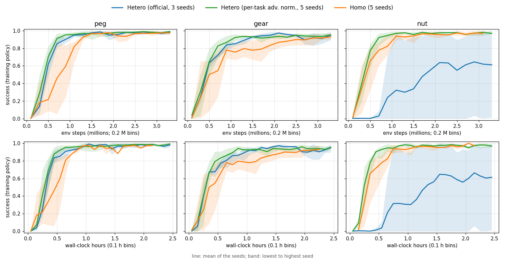
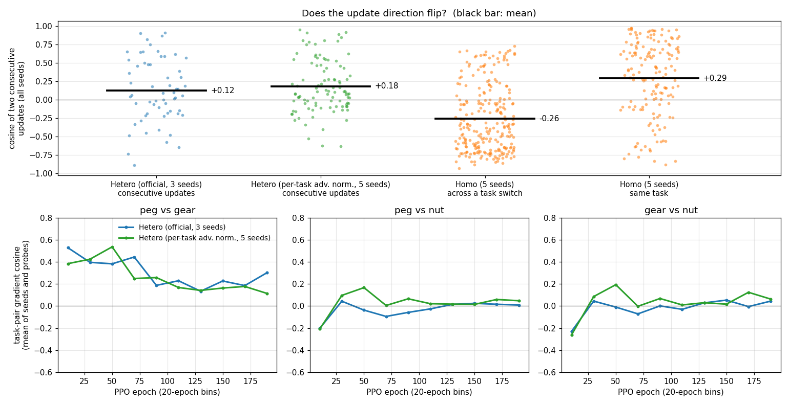
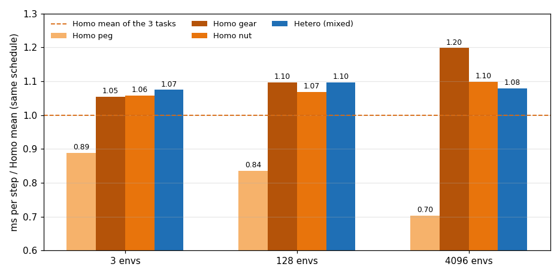
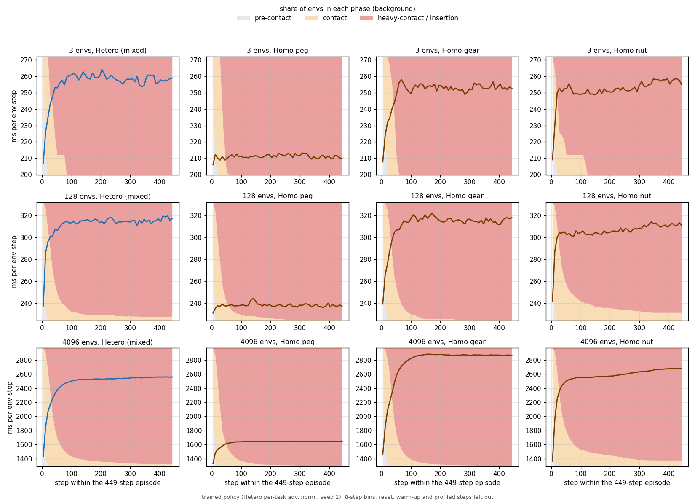
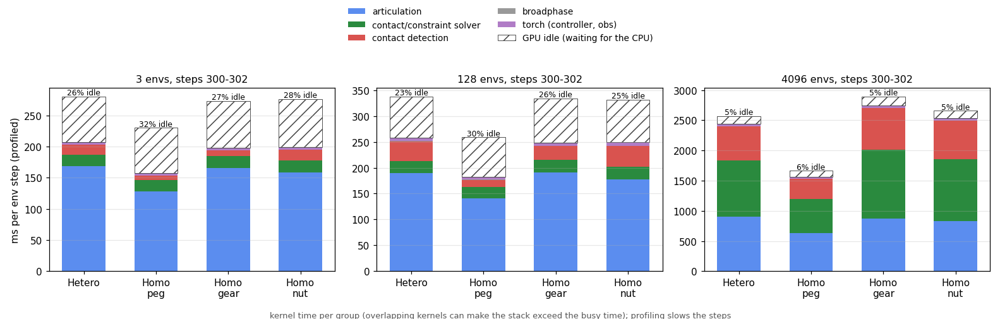
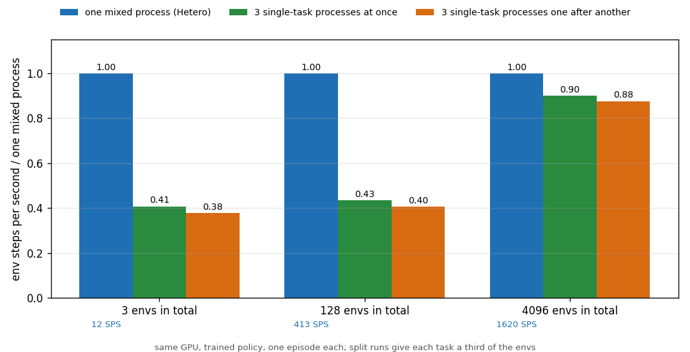
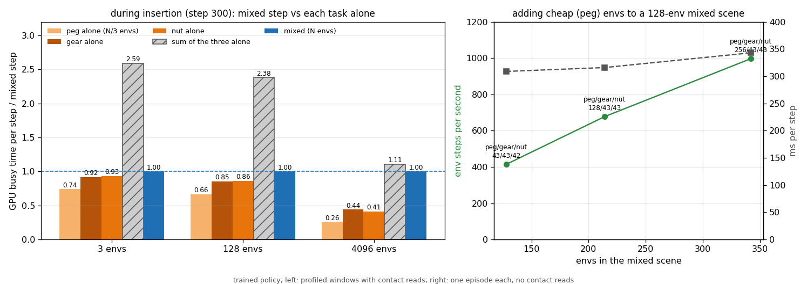

# Isaac / PhysX results (by RULES section)

Status 2026-10-08. Chinese version: [README.zh-TW.md](README.zh-TW.md). How to run: [../README.md](../README.md). Raw logs, checkpoints and videos are on gputw1 and are not in the repository.

## 1. Task families

- **Factory**: done on PhysX (everything below).
- **Play2Perfect**: the official example runs on gputw1 in its own environment (Isaac Lab 2.3.2.post1, the repository's vendored rl_games). Official offline evaluation of the released policies, 1024 envs, first episode per env:

  | Task | Success |
  |---|---|
  | Tight insertion | 96.9% |
  | Beam assembly, step 1 | 97.1% |
  | Beam assembly, step 2 | 92.2% |
  | Screwing | 61.4% |

- Every released checkpoint has 6 SAPG blocks, i.e. it was trained with 24,576 envs. The repository's default config uses 8,192 envs (2 blocks), so stage-2 finetuning from the released play policy fails to load. Finetuning needs `env.scene.num_envs=24576`.
- Homo/Hetero on Play2Perfect is scheduled after Factory.

## 2. Backend settings

- Isaac Sim 5.1.0 (PhysX 5.6.1 / omni.physx 107.3), Isaac Lab v2.3.2, RTX PRO 6000 Blackwell Workstation, driver 595.84.
- Official Factory simulation settings, unchanged:
  - physics dt 1/120 s;
  - 8 physics steps per policy step;
  - 192 solver position iterations;
  - `gpu_max_num_partitions` 1;
  - official GPU buffers, except the collision stack: 1 GB (Hetero) or 2 GB (Homo) at >= 1024 envs, because the official 2^28 bytes drop contacts there.

## 3. RL setup

- Official rl_games PPO config of the Factory tasks:
  - LSTM, asymmetric critic;
  - horizon 128, minibatch 512 (384 at 3 envs);
  - 200 epochs.
- One shared policy; the task enters the observation as a one-hot.
- Changes to the official settings are listed in [../README.md](../README.md#changes-to-the-official-settings).

## 4. Main experiments (128 envs)

Final success, deterministic evaluation (2 episodes × 128 envs per task); mean of seeds, peg / gear / nut:

| Group | Seeds | Success |
|---|---|---|
| Hetero, official advantage normalisation | 3 | 87 / 88 / **42**% (nut per seed: 65, 6, 55) |
| Hetero, per-task advantage normalisation | 5 | 92 / 83 / 90% |
| Homo (task switch every 4 updates) | 5 | 91 / 83 / 92% |

Training success during the first 1 M env steps (peg / gear / nut):

| Group | Success |
|---|---|
| Hetero (official) | 0.53 / 0.52 / 0.06 |
| Hetero (per-task) | **0.60 / 0.56 / 0.64** |
| Homo | 0.29 / 0.41 / 0.52 |

Wall-clock time (200 epochs, old pose read):

| Group | Total | Simulation |
|---|---|---|
| Hetero | 2.44-2.45 h | 2.25 h |
| Homo | 2.21 h | 2.02 h |

Line: mean of the seeds; band: lowest to highest seed. Return vs steps and time: [figures/n128_return.png](figures/n128_return.png).

- **With the official setting, Hetero loses on the nut task.** rl_games normalises the advantages of the whole rollout together. In a Hetero rollout the nut task, whose early rewards are small, is pushed negative as a whole: mean about -1.2, std 0.14-0.35 in the first epochs. One seed never learns it.
- **Per-task normalisation removes the problem.** Hetero then learns all three tasks faster than Homo, per sample and per hour, and ends equal.
- **RULES "run once" set** (`rules_*`, current code, official advantage normalisation, seed 0, checkpoints every 20 epochs). Success at epoch 200:

  | Group | Peg / gear / nut | Total time |
  |---|---|---|
  | Hetero | 84 / 94 / 62% | 2.41 h |
  | Homo | 97 / 78 / 96% | 2.20 h |

  These match the earlier seed-0 runs. Curves: [figures/rules_n128_success.png](figures/rules_n128_success.png).
- **3 and 4096 envs**: the RULES runs (official 200 epochs at every scale) are in progress. An earlier provisional run gave 4096 envs the same env steps as 128 (only 6 updates); neither group learned.

## 5. Gradients (128 envs)

1. **Does the direction flip when Homo switches tasks?** Yes. Consecutive updates across a switch have cosine -0.21 to -0.32 (5 seeds); within a task, +0.23 to +0.35.
2. **Do task gradients conflict?**
   - Peg and gear mostly agree (+0.2 to +0.35).
   - Nut against either of the others is near orthogonal on average, and negative 30-60% of the time.
3. **Is Hetero more balanced?** Not with the official normalisation: the nut signal is suppressed. With per-task normalisation, all three tasks get signals of the same size.
4. **Does the learning benefit pay for the slower simulation?** Not with the official normalisation; yes with per-task normalisation.

## 6. Profiling with trained policies

`scripts/bench_policy.py` with the trained policy (Hetero, per-task normalisation, seed 1):

- whole episodes, timed like training;
- contacts of each env's held part with its fixed part and with the fingers, read from PhysX every step;
- three phases per env:
  - pre-contact;
  - contact;
  - heavy contact / insertion (the official "engaged" check);
- kernel profiles at step 5 (pre-contact) and step 300 (insertion).

| | 3 envs | 128 envs | 4096 envs |
|---|---|---|---|
| Straggler Ratio (slowest Homo task / mean of the three) | 1.06 | 1.10 | 1.20 |
| Hetero / Homo mean (training schedules) | 1.07 | 1.09 | 1.08 |
| Hetero / slowest single task | 1.02 | 1.00 | 0.90 |
| GPU idle, waiting for the CPU (profiled steps) | 26-34% | 23-31% | 5-7% |
| SPS, Homo peg / gear / nut | 14 / 12 / 12 | 522 / 401 / 411 | 2458 / 1463 / 1588 |
| SPS, Hetero | 12 | 403 | 1610 |

- **Small scenes wait for the heaviest contact.** At 3 and 128 envs the GPU is not full, and a mixed step takes as long as the slowest single task. At 4096 envs the GPU is saturated (95% busy), and a mixed step falls between the mean and the slowest task.
- **The extra time comes from insertion contacts.**
  - Before contact the three tasks take about the same time per step.
  - Once the gear and the nut are engaged, a step costs about 40 ms (3 envs), 70 ms (128) or 1.2 s (4096) more. The peg costs almost nothing extra.
  - Contact points per env while engaged: peg about 85, gear about 106, nut about 250.
- **The cost of mixing stays at 7-9% across scales**, while the imbalance between tasks (Straggler Ratio) grows from 1.06 to 1.20.
- **Contact detection is sized for the most complex part.** At 128 envs, before any insertion, a mixed scene spends 25 ms on contact detection, close to the nut alone (28 ms), while peg and gear alone take 14-15 ms. Nsight agrees: the convex-vs-mesh midphase is 1.5-2.5× slower in mixed scenes.
- **Bottleneck**: contact and constraint solving (inside the articulation kernels at small scale, an inference since the parts are one-link articulations; in the solver kernels at 4096 envs), then contact detection. About 2,250 kernel launches per physics step at every scale give a fixed cost that leaves the GPU waiting for the CPU at small scale.
- **Random actions underestimate mixing.** Random actions never mate the parts, so the three tasks cost about the same: 6-9% slowdown with random actions vs 12% in training. A trained policy reproduces the 12% of training ([figures/policy_vs_random_step_time.png](figures/policy_vs_random_step_time.png): Hetero follows the slowest task with the trained policy; with random actions the three tasks stay close).

## 7. How PhysX runs heterogeneous envs (source: PhysX 5.6.1)

1. **Storage**: the whole GPU scene is one island. Bodies, articulations and contacts are batched by type, not by env. Articulations are processed in blocks of 32, padded to the largest link count (Franka: 11 links).
2. **Processing**: every env goes through the same shared kernels. Every env does the same 192 position iterations; the iteration count is the scene-wide maximum, and there is no early exit on convergence.
3. **Do small envs wait for large ones?** Yes. Each kernel ends when its heaviest work finishes, and several buffer sizes and launch grids follow scene-wide maxima.
4. **Padding, divergence, synchronisation**:
   - Padding exists (articulation blocks, maxima-sized buffers).
   - Warp-level divergence is not the main cost: putting each task's envs in contiguous blocks changed step time by less than 1%.
   - Each physics step makes about 2,300 kernel launches regardless of env count (no CUDA graphs).
5. **Main bottleneck**: contact and constraint solving over the 192 iterations, and the fixed launch cost at small scale. Cross-env synchronisation itself is not the main cost.

## 8. Validation and reproducibility

- **Hardware and software**: same GPU and versions for every run (recorded in each `run_info.json`).
- **Rendering**: disabled during training and timing.
- **Budgets**: Homo and Hetero have the same env-step budget and the same samples per task after each cycle.
- **Warm-up**: excluded from timing.
- **RULES "run once" set**:
  - checkpoints every 20 epochs;
  - deterministic evaluation (1 episode × 128 envs per task) at epochs 40, 80, 120, 160 and 200;
  - a 30 s low-resolution video at each of those epochs, drawn offline because the RTX renderer crashes on this driver.
- **Raw data**: in the owner's notes and on gputw1.

## Beyond RULES (and why)

| Item | Why |
|---|---|
| More seeds at 128 envs (3-5) | Seed 1 of official Hetero never learned the nut task; one seed could not show whether that was typical |
| Per-task advantage normalisation | To test, and confirm, why official Hetero loses the nut task |
| Trained-policy timing, Nsight | Random actions underestimate the cost of mixing |
| One-read pose of the active parts | Removed 2% of a Hetero step that came from our code, not PhysX |
| Big-list scene | Measures what the union scene's parked parts cost |

## Meeting TODOs (2026-10-07), in progress

- **TODO1** (fair normalisation for Homo): `--adv_norm pooled` runs (Homo, 128 envs, 3 seeds) are queued.
- **TODO2** (split the simulation over several processes on one GPU): **no gain; one mixed process is fastest** at every scale. Env steps per second, all tasks together:

  | Total envs | One mixed process | Three single-task processes at once | Three single-task processes one after another |
  |---|---|---|---|
  | 3 | 12 | 4.9 (0.41×) | 4.5 (0.38×) |
  | 128 | 413 | 179 (0.43×) | 167 (0.40×) |
  | 4096 | 1620 | 1458 (0.90×) | 1419 (0.88×) |

  - **The GPU serves the processes in turns.** Without MPS it time-slices them: under concurrency each process's step takes about the sum of the three processes' steps alone.
  - **At small scale most of a step is a fixed cost.** About 2,300 kernel launches per physics step, whatever the env count. Splitting the envs pays that cost three times; mixing pays it once.

  
- **TODO3** (finer profiling during insertion). The mixed step (N envs, profiled at step 300) is compared with each task alone at N/3 envs:

  | Envs | Mixed vs slowest task alone | Mixed vs sum of the three | Share of the mixed step that peg / gear / nut envs wait |
  |---|---|---|---|
  | 3 | 1.07× | 0.39× | 26 / 8 / 7% |
  | 128 | 1.16× | 0.42× | 34 / 15 / 14% |
  | 4096 | 2.27× | 0.90× | no idle wait (the work adds up) |

  - **Side by side at small scale.** At 3 and 128 envs the tasks run side by side, so cheap tasks wait for the heaviest.
  - **Filling the wait.** Adding cheap peg envs to the 128-env mixed scene:

    | Peg / gear / nut envs | Step time | Total env steps per second |
    |---|---|---|
    | 42 / 43 / 43 (even) | baseline | baseline |
    | 128 / 43 / 43 | +2% | 1.63× |
    | 256 / 43 / 43 | +11% | 2.41× |

  - **Grouping by difficulty.** Gear + nut mixed (309 ms) costs the same as the full three-task mix (307 ms). Running "peg alone" and "gear + nut" in turns, with equal samples per task, costs 283 ms per 128 env steps: Homo 277, full mix 307.

  
