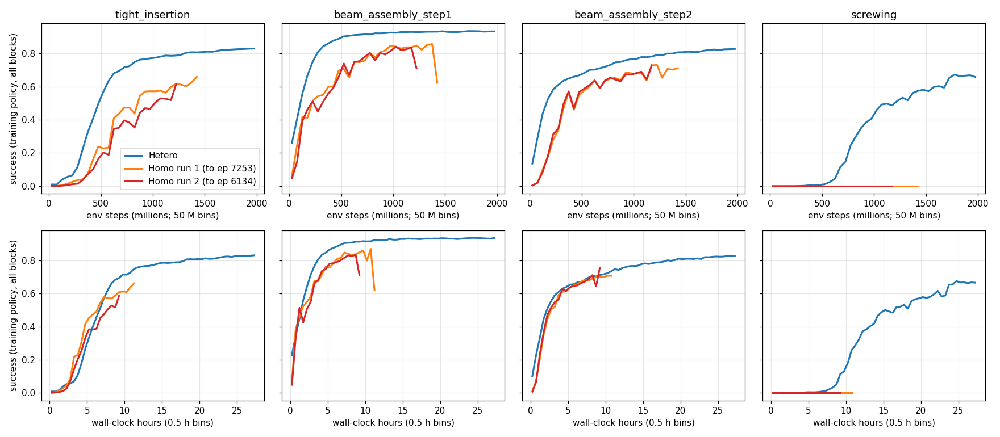
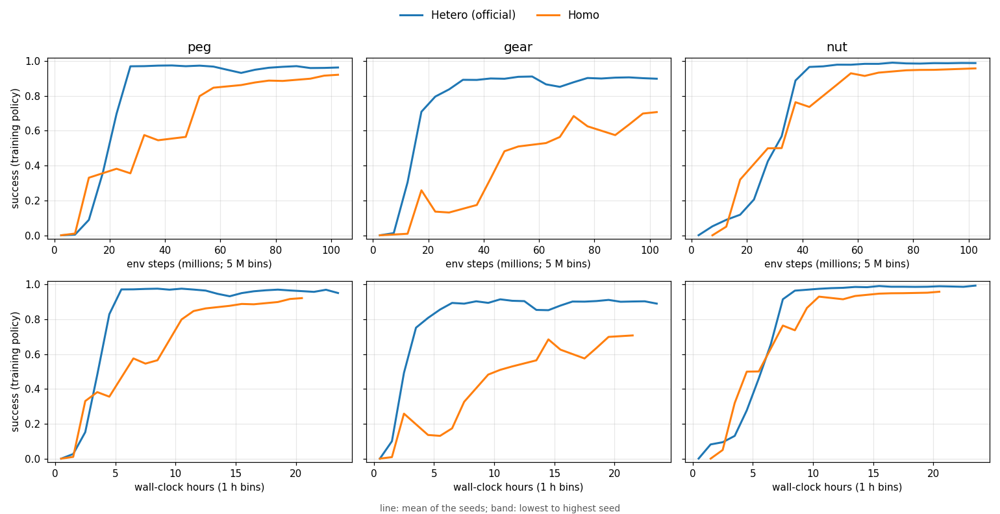
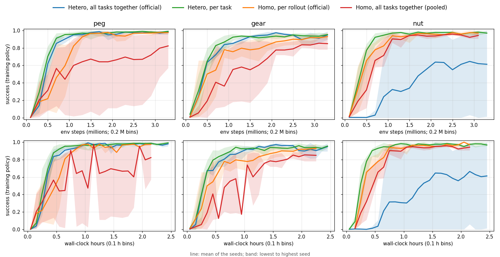

# Isaac / PhysX 結果（照 RULES 章節）

2026-10-10 的狀態。英文版：[README.md](README.md)。怎麼跑：[../README.zh-TW.md](../README.zh-TW.md)。原始紀錄、存檔、影片在 gputw1 上，不放進 repo。

## 1. 任務

- **Factory**：PhysX 這邊做完了（下面的內容都是）。
- **Play2Perfect**：官方範例在 gputw1 上能跑，用它自己的環境（Isaac Lab 2.3.2.post1、repo 自帶的 rl_games）。官方的離線評估，用釋出的策略、1024 個環境、每個環境算第一個回合：

  | 任務 | 成功率 |
  |---|---|
  | 緊配合插入 | 96.9% |
  | 橫樑組裝第一步 | 97.1% |
  | 橫樑組裝第二步 | 92.2% |
  | 鎖螺絲 | 61.4% |

- 釋出的存檔都是 6 組 SAPG。play 策略用 24,576 個環境（每組 4096）；四個第二階段的策略用 12,288 個環境、每組 2048，輪數從 0 算（從存檔本身讀出來的）。repo 的預設（8,192 個環境、每組 4096）只有 2 組，所以從釋出的 play 策略接著做第二階段訓練會載入失敗；12,288 個環境、每組 2048 就載得進去。
- Play2Perfect 的 Homo／Hetero（2026-10-13；一個種子、官方的 advantage 標準化、12,288 個環境；聯集場景用官方策略驗證過：95.9／97.3／92.3／61.0%，官方 96.9／97.1／92.2／61.4%）。關掉隨機性的評估，緊配合插入／橫樑第一步／橫樑第二步／鎖螺絲：

  | 第幾輪 | Hetero | Homo 第一次 | Homo 第二次 |
  |---|---|---|---|
  | 2,000 | 30／88／66／0% | 3／66／52／0% | 2／60／54／0% |
  | 6,000 | 71／96／83／46% | 32／88／75／0% | 21／86／72／0% |
  | 10,000 | 83／96／88／62% | 壞掉 | 壞掉 |

  - **Homo 在官方規模下 GPU 記憶體不夠。** 兩次都在 PhysX 要不到記憶體時壞掉（第 7,254、6,135 輪）：Homo 一段時間全部 12,288 個環境做同一個任務，接觸多的任務把接觸全擠在同一段（最多 92.6 GB；Hetero 最多 48.8 GB）。2026-10-13 決定當成結果，不再重跑。
  - 同樣樣本，Hetero 每個任務都學得比較快，只有 Hetero 學會鎖螺絲（Homo 壞掉前已做了 3 億多步的鎖螺絲，約是 Hetero 開始學會所需的兩倍）。按時間，緊配合插入和兩個橫樑兩邊差不多（Homo 每輪約 5.5 秒，Hetero 約 10 秒）。
  - 速度：混在一起的一步跟鎖螺絲單獨差不多貴（12,288 個環境每步 574 對 717 ms）；只要 768 個鎖螺絲環境混在緊配合插入裡，每步就從 70 ms 變 485 ms。鎖螺絲的桌腳一重設就碰到治具，所以把接觸階段在時間上對齊，在這裡沒辦法讓每步變便宜（[figures/p2p_alignment.png](figures/p2p_alignment.png)）。

  

## 2. 模擬器設定

- Isaac Sim 5.1.0（PhysX 5.6.1／omni.physx 107.3）、Isaac Lab v2.3.2、RTX PRO 6000 Blackwell Workstation、驅動 595.84。
- 官方 Factory 的模擬設定都沒改：
  - 物理步 1/120 秒；
  - 每個策略步 8 個物理步；
  - 位置迭代 192 次；
  - `gpu_max_num_partitions` 1；
  - GPU 暫存區用官方值，只有碰撞暫存區在 1024 個環境以上加大到 1 GB（Hetero）或 2 GB（Homo），因為官方的 2^28 會丟接觸。

## 3. RL 設定

- 官方 Factory 的 rl_games PPO 設定：
  - LSTM、非對稱 critic；
  - 每次收 128 步、minibatch 512（3 個環境時 384）；
  - 200 輪。
- 三個任務共用一個策略，觀測裡加任務的 one-hot。
- 對官方設定的改動列在 [../README.zh-TW.md](../README.zh-TW.md#對官方設定的改動)。

## 4. 主實驗（128 個環境）

最後的成功率（關掉隨機性，每個任務 2 回合 × 128 個環境；種子平均，插銷／齒輪／螺帽）：

| 組 | 種子 | 成功率 |
|---|---|---|
| Hetero，官方的 advantage 標準化 | 3 | 87／88／**42**%（螺帽各種子：65、6、55） |
| Hetero，按任務標準化 | 5 | 92／83／90% |
| Homo（每 4 次更新換一次任務） | 5 | 91／83／92% |

前 100 萬步的訓練成功率（插銷／齒輪／螺帽）：

| 組 | 成功率 |
|---|---|
| Hetero（官方） | 0.53／0.52／0.06 |
| Hetero（按任務標準化） | **0.60／0.56／0.64** |
| Homo | 0.29／0.41／0.52 |

訓練時間（200 輪，舊的讀取寫法）：

| 組 | 總共 | 其中模擬 |
|---|---|---|
| Hetero | 2.44 到 2.45 小時 | 2.25 小時 |
| Homo | 2.21 小時 | 2.02 小時 |

線是種子的平均，陰影是最低到最高的種子。獎勵對步數、對時間：[figures/n128_return.png](figures/n128_return.png)。

- **照官方設定，Hetero 輸在螺帽**：rl_games 把一整批的 advantage 一起標準化。Hetero 的一批裡，螺帽一開始獎勵很小，整體被判成負的（前幾輪平均約 −1.2、標準差 0.14 到 0.35），有一個種子始終學不會。
- **改成每個任務各自標準化之後問題就消失了**：Hetero 三個任務都學會，前期按樣本、按時間都比 Homo 快，最後一樣好。
- **三個任務一起標準化對 Homo 也不好**（下面開會的 TODO1），所以官方 Homo 在螺帽贏，是標準化方式造成的。
- **RULES「每個實驗跑一次」的正式版**（`rules_*`，現在的程式、官方的 advantage 標準化、種子 0、每 20 輪存檔）。第 200 輪的結果：

  | 組 | 插銷／齒輪／螺帽 | 總時間 |
  |---|---|---|
  | Hetero | 84／94／62% | 2.41 小時 |
  | Homo | 97／78／96% | 2.20 小時 |

  跟之前的種子 0 一樣。曲線：[figures/rules_n128_success.png](figures/rules_n128_success.png)。
- **3 個環境**（RULES 正式版，官方 200 輪）：兩邊都沒學會。3 個環境跑 200 輪只有 7.7 萬步，是 128 個環境的 43 分之一；每個存檔的成功率都是 0 到 8%。只能看時間：

  | 組 | 總共 | 其中模擬 |
  |---|---|---|
  | Hetero | 1.66 小時 | 1.63 小時 |
  | Homo | 1.60 小時 | 1.57 小時 |

  Hetero 的模擬多 4%，比第 6 節的 7% 小，因為沒學會的策略很少真的把零件插進去。Homo 的時間扣掉了 7.1 小時的暫停（別人的程式開始用 GPU 時，守門程式把訓練停下來）。
- **4096 個環境**（RULES 正式版，官方 200 輪，1 億 500 萬步）：**Hetero 明顯比 Homo 好**，跟 128 個環境不一樣。

  | 第幾輪 | Hetero（官方），關掉隨機性的評估 | Homo |
  |---|---|---|
  | 40 | 28／62／9% | 27／0／18% |
  | 80 | 97／86／89% | 52／20／46% |
  | 200 | 97／83／97% | 85／42／96% |

  | 組 | 總共 | 其中模擬 | GPU 記憶體（最多） |
  |---|---|---|---|
  | Hetero | 23.0 小時 | 17.5 小時 | 37.5 GB |
  | Homo | 21.3 小時 | 15.8 小時 | 32.7 GB |

  - Hetero 的插銷、齒輪學得快很多，按樣本、按時間都是，雖然模擬多花 11%（跟 128 個環境一樣）。Homo 的齒輪一直很低（最後五分之一的訓練成功率 65%，第 200 輪評估 42%）。螺帽兩邊差不多。
  - 這次 Hetero 的螺帽在評估時沒有掉下來（97%），跟 128 個環境的種子 0（62%）不一樣。各只有一個種子，分不出是規模的關係還是運氣。
  - Homo 為什麼在 4096 個環境落後，還沒確定。一個推論：minibatch 一樣是 512，所以 4096 個環境每輪的梯度更新次數是 32 倍；Homo 在一個任務上連續 4 輪，就是連續幾千次只看一個任務的更新，比較容易忘掉別的任務。Homo 的齒輪曲線一直上上下下，符合這個說法，但沒有驗證過。
  - Homo 換任務前後兩次更新的 cosine 平均 0.04，同一個任務內 0.14（128 個環境是 −0.30 和 +0.27）。

  

## 5. 梯度（128 個環境）

1. **Homo 換任務時方向會不會突然改變？** 會。換任務前後兩次更新的 cosine 是 −0.21 到 −0.32（5 個種子）；同一個任務內是 +0.23 到 +0.35。
2. **任務之間的梯度會不會衝突？**
   - 插銷和齒輪大多同向（+0.2 到 +0.35）。
   - 螺帽跟另外兩個平均接近垂直，三到六成的時候是反向。
3. **Hetero 的更新是不是比較平衡？** 官方標準化下不平衡，螺帽的訊號被壓掉；按任務標準化後三個任務的訊號一樣大。
4. **學習的好處補不補得回模擬比較慢？** 官方標準化下補不回來；按任務標準化後可以。

## 6. 用訓練好的策略做的剖析

`scripts/bench_policy.py`，策略是按任務標準化的 Hetero 種子 1。量法：

- 跑完整的回合，跟訓練一樣計時；
- 每一步從 PhysX 讀「手上零件↔固定零件」和「手上零件↔手指」的接觸；
- 每個環境分三個階段：
  - 接觸前；
  - 接觸中；
  - 重度接觸／插入（官方 reward 的 engaged 判定）；
- 在第 5 步（接觸前）和第 300 步（插入中）錄 GPU 程式。

| | 3 個環境 | 128 個環境 | 4096 個環境 |
|---|---|---|---|
| Straggler Ratio（最慢的 Homo 任務 ÷ 三個平均） | 1.06 | 1.10 | 1.20 |
| Hetero ÷ Homo 平均（各自訓練的時間表） | 1.07 | 1.09 | 1.08 |
| Hetero ÷ 最慢的單一任務 | 1.02 | 1.00 | 0.90 |
| GPU 在等 CPU 的比例（錄的那幾步） | 26% 到 34% | 23% 到 31% | 5% 到 7% |
| 每秒環境步數：Homo 插銷／齒輪／螺帽 | 14／12／12 | 522／401／411 | 2458／1463／1588 |
| 每秒環境步數：Hetero | 12 | 403 | 1610 |

- **小場景會等接觸最重的那個任務**：3、128 個環境時 GPU 沒塞滿，混在一起的一步跟最慢的單一任務一樣久。4096 個環境時 GPU 塞滿（95% 在做事），混在一起落在平均和最慢之間。
- **多出來的時間來自插入時的接觸**：
  - 接觸前三個任務每步差不多快。
  - 齒輪、螺帽插進去之後，每步多約 40 ms（3 個環境）、70 ms（128 個）、1.2 秒（4096 個）；插銷幾乎不多。
  - 插入時每個環境的接觸點數：插銷約 85、齒輪約 106、螺帽約 250。
- **混在一起的代價三個規模都在 7% 到 9%**；任務之間的差距（Straggler Ratio）則從 1.06 變大到 1.20。
- **接觸偵測照最複雜的零件準備**：128 個環境、還沒插入時，混在一起的接觸偵測是 25 ms，接近螺帽單獨的 28 ms，插銷、齒輪單獨只要 14 到 15 ms。Nsight 也看到混在一起時，凸包碰網格的 midphase 慢 1.5 到 2.5 倍。
- **瓶頸**：主要在接觸和約束的解算，其次是接觸偵測。
  - 小規模時這部分算在關節程式裡。這是推論：零件是一節的 articulation。
  - 4096 個環境時在解算程式裡。
  - 每個物理步叫 GPU 約 2250 次，這個固定成本讓 GPU 在小規模時有兩到三成的時間在等 CPU。
- **亂數動作會低估混在一起的代價**：亂數動作不會真的把零件裝上去，三個任務的時間接近，只量到慢 6% 到 9%；訓練時是 12%。用訓練好的策略計時，重現了訓練時的 12%（[figures/policy_vs_random_step_time.png](figures/policy_vs_random_step_time.png)：訓練好的策略下 Hetero 跟著最慢的任務走；亂數動作下三個任務很接近）。

## 7. PhysX 怎麼跑不同的環境（原始碼：PhysX 5.6.1）

1. **怎麼存**：整個 GPU 場景是一個島。剛體、關節物體、接觸照種類放在一起，不照環境分。關節物體 32 個一組，補齊到最多的節數（Franka 11 節）。
2. **怎麼算**：所有環境用同一批 GPU 程式。每個環境都做一樣的 192 次位置迭代：迭代數取全場最大值，沒有「收斂就停」。
3. **小環境要不要等大環境**：要。每個 GPU 程式要等最重的那部分做完；好幾個緩衝區和程式的大小照全場最大值決定。
4. **補齊、分歧、同步**：
   - 有補齊：關節物體的組、照最大值開的緩衝區。
   - 執行緒分歧不是主因：把同任務的環境排在一起，速度差不到 1%。
   - 每個物理步叫 GPU 約 2300 次，跟環境數無關（沒有用 CUDA Graph）。
5. **主要瓶頸**：192 次迭代裡的接觸和約束解算，以及小規模時叫 GPU 的固定成本；跨環境的同步本身不是主因。

## 8. 驗證和重現

- **硬體和軟體**：每次都用同一張 GPU、同樣的版本（每個 `run_info.json` 都有記）。
- **算圖**：訓練和計時都不開。
- **訓練量**：Homo 和 Hetero 用同樣的總步數，每個循環後每個任務的樣本數一樣。
- **暖機**：不算進計時。
- **RULES 正式版**：
  - 每 20 輪存檔；
  - 第 40、80、120、160、200 輪做關掉隨機性的評估（每個任務 1 回合 × 128 個環境）；
  - 同樣這幾輪各錄一支 30 秒的低解析度影片。因為這個驅動下 RTX 算圖器會當掉，影片是離線畫的。
- **原始資料**：在負責人的筆記和 gputw1 上。

## 超出 RULES 的部分（和原因）

| 項目 | 為什麼 |
|---|---|
| 128 個環境多跑幾個種子（3 到 5 個） | 官方 Hetero 的種子 1 始終學不會螺帽，一個種子看不出這是不是常態 |
| 按任務標準化 advantage | 找出、證實官方 Hetero 輸在螺帽的原因 |
| 用訓練好的策略計時、Nsight | 亂數動作會低估混在一起的代價 |
| 讀零件位置一次讀完 | 去掉 Hetero 每步約 2% 來自我們程式（不是 PhysX）的成本 |
| 大 list 場景 | 量聯集場景停放零件的代價 |

## 10/07 開會的 TODO

- **TODO1**（Homo 公平的標準化）：`--adv_norm pooled` 讓 Homo 跟官方 Hetero 一樣：每一批用「三個任務最近各一批」合起來的統計量標準化。Homo、128 個環境、3 個種子。最後的成功率，插銷／齒輪／螺帽：

  | | 三個任務一起標準化 | 每個任務自己標準化 |
  |---|---|---|
  | Hetero | 87／88／**42**%（官方，3 個種子） | 92／83／90%（5 個種子） |
  | Homo | 86／**70**／82%（pooled，3 個種子） | 91／83／92%（官方，5 個種子） |

  - **一起標準化對兩邊都不好**：Hetero 傷螺帽；Homo 的插銷、齒輪學得慢，齒輪三個種子最後都比官方 Homo 最差的種子低（64 到 74%，官方最低 75%）。
  - **每個任務自己標準化時，Hetero 和 Homo 最後一樣好**，Hetero 前期學得快。兩邊都各自標準化時，混在一起學沒有吃虧。
  - **量到的偏移**：前 50 輪，一起標準化讓 Homo 每一批的 advantage 平均移動 +0.25（插銷）、+0.37（齒輪）、−0.44（螺帽）；之後接近 0。為什麼 Hetero 和 Homo 傷到的任務不一樣，還不知道。

  
- **TODO2**（同一張 GPU 上把模擬拆成幾個程序同時跑）：**沒有比較快，一個程序混在一起最快**，三個規模都一樣。每秒環境步數（三個任務加起來）：

  | 總環境數 | 一個程序混在一起 | 三個單任務程序同時跑 | 三個單任務程序輪流跑 |
  |---|---|---|---|
  | 3 | 12 | 4.9（0.41 倍） | 4.5（0.38 倍） |
  | 128 | 413 | 179（0.43 倍） | 167（0.40 倍） |
  | 4096 | 1620 | 1458（0.90 倍） | 1419（0.88 倍） |

  - **GPU 是輪流服務各個程序**：沒有 MPS 時 GPU 會輪流切換，同時跑時每個程序的一步，差不多等於三個程序單獨跑加起來。
  - **環境少時每一步的成本大部分是固定的**：每個物理步叫 GPU 約 2300 次，跟環境數無關。拆開要付三次，混在一起只付一次。

  
- **TODO3**（插入時更細的剖析）：把混在一起的一步（N 個環境，第 300 步）跟每個任務自己用 N/3 個環境跑的一步比：

  | 環境數 | 混在一起 ÷ 最慢的任務 | 混在一起 ÷ 三個加起來 | 插銷／齒輪／螺帽的環境陪等的比例 |
  |---|---|---|---|
  | 3 | 1.07 倍 | 0.39 倍 | 26／8／7% |
  | 128 | 1.16 倍 | 0.42 倍 | 34／15／14% |
  | 4096 | 2.27 倍 | 0.90 倍 | 沒有空等（工作直接相加） |

  - **環境少時是並排做的**：3、128 個環境時，三個任務在 GPU 上並排做，便宜的任務等最重的。
  - **把等待填滿**：128 個環境的混合場景多加便宜的插銷環境：

    | 插銷／齒輪／螺帽 | 每步時間 | 每秒總步數 |
    |---|---|---|
    | 42／43／43（平均分） | 基準 | 基準 |
    | 128／43／43 | 慢 2% | 1.63 倍 |
    | 256／43／43 | 慢 11% | 2.41 倍 |

  - **照難度分組**：齒輪＋螺帽混在一起（309 ms）跟三個全混（307 ms）一樣快。「插銷一組、齒輪＋螺帽一組」輪流跑，每個任務樣本一樣多時，每 128 個環境步 283 ms；Homo 是 277，全混是 307。

  
