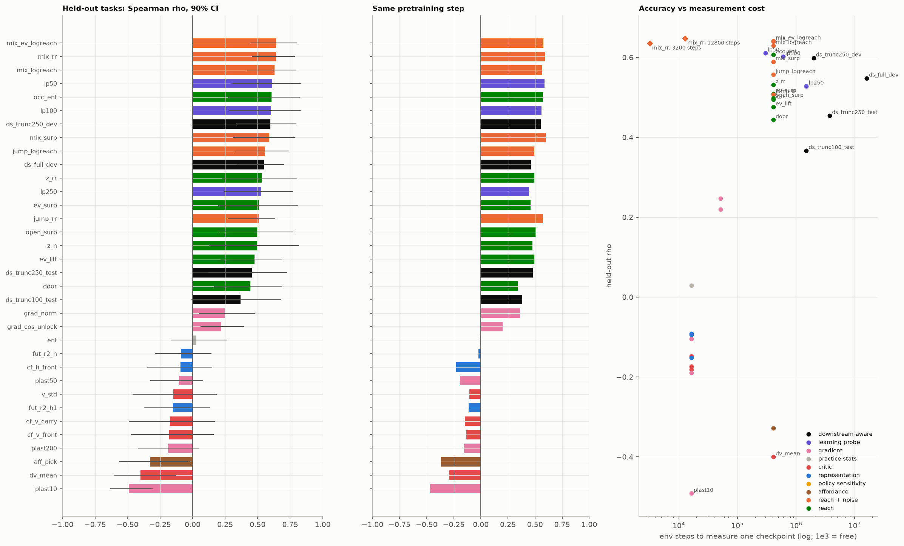
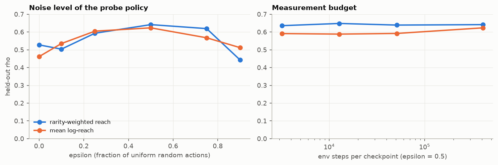
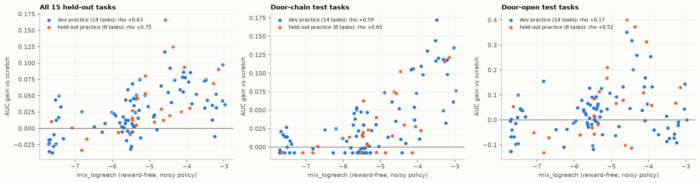
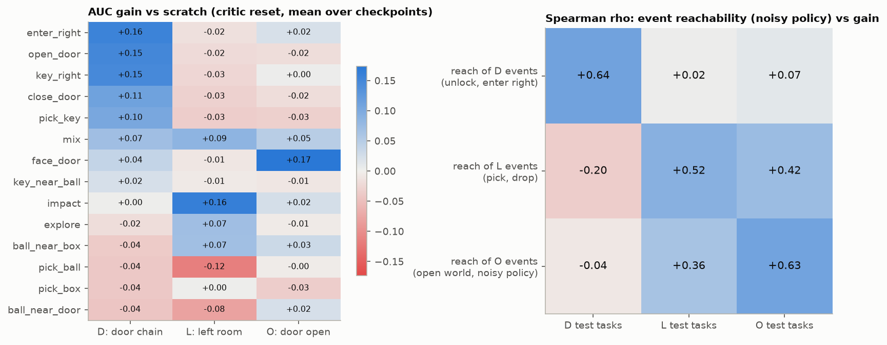
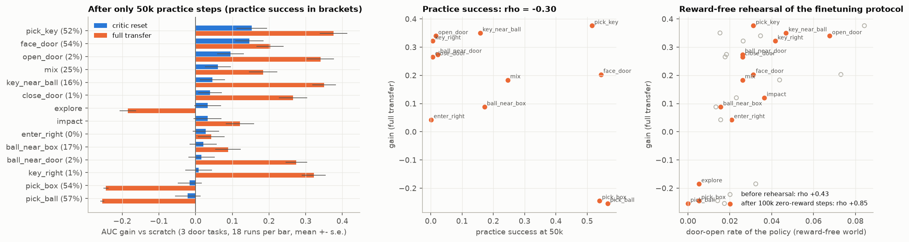
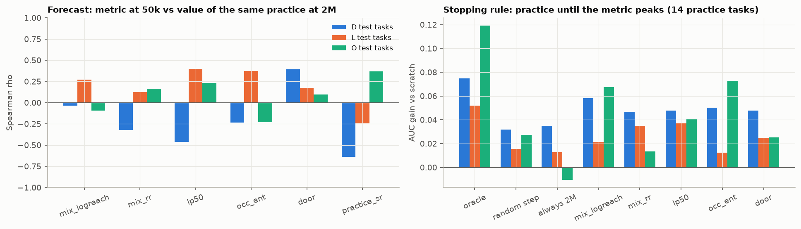
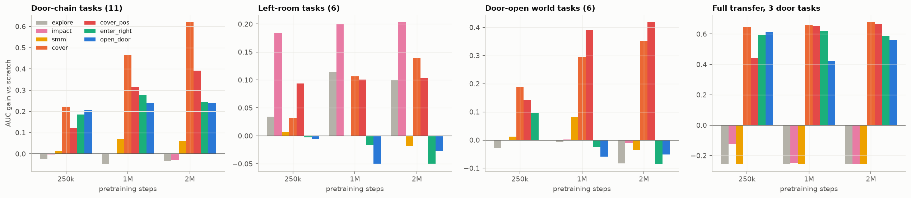
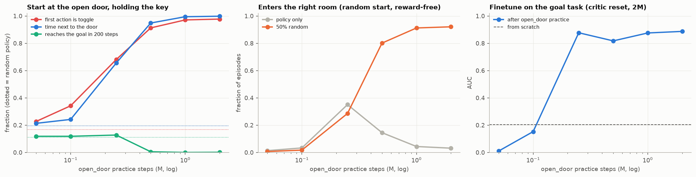

# How can we measure the future learning potential of a pretrained policy?

研究問題：不跑下游 finetuning，能不能便宜地量出一個 pretraining checkpoint「未來有多容易學會新任務」？

數字都來自 `results/potential.txt`（`uv run python analyze.py pot_report` 產生）。圖在 `figs/fig_pot*.png`。

主線故事（覆蓋率 → 用覆蓋率當 pre-training 目標）整理在 `STORY.md`；這份是完整的實驗紀錄。

---

## 0. TL;DR

| # | 結論 | 證據 |
|---|---|---|
| 1 | **練習任務的成功率不是 practice value。** 和下游 learnability 的相關接近 0（ρ = −0.08），在 held-out 練習上也是 0.02。 | 2.1 |
| 2 | **目前最好的 metric 是「加了雜訊的 policy 的可達性」**（`mix_logreach`）：在沒有 reward 的世界裡，讓 policy 有 50% 的動作改成隨機，量它能走到哪些抽象狀態，取 log 機率的平均。Held-out 任務上 ρ = 0.63；開發時完全沒用到的 8 種新練習上 ρ = 0.75。成本只要 3,200 env steps（純推論），是下游 finetuning 的萬分之一，準確度卻和花 500–5000 倍成本的 downstream-aware 基準線相當或更好。 | 2.2 |
| 3 | **它有效的原因**：finetuning 的第一步是「先碰到成功」，再把成功變成習慣。雜訊 policy 的可達性同時量到這兩件事：能碰到多少地方（discovery），以及能多可靠地走到深處（縮短要學的剩餘行為鏈，consolidation）。 | 2.3 |
| 4 | **但不存在通用的 practice value。** 同一個 checkpoint 對三個任務 family 的價值幾乎不相關（ρ = −0.09 ~ 0.32）。改量「這個 family 需要的事件的可達性」，每個 family 都能預測（ρ = 0.52–0.64），跨 family 就失效（−0.20 ~ 0.42）。所謂「不需要知道下游任務的 metric」，其實是隱含了一個任務先驗。 | 2.4 |
| 5 | **早期 checkpoint 的價值有一大半在 critic 裡。** open_door 只練 50k 步（成功率 2%），整個網路搬過去時增益是 +0.34（p = 1e-10，18 runs）；只重置 critic 時只剩 +0.10。原因是 advantage normalization 把很小的 V 放大成完整強度的 shaping 訊號。用「零 reward 的 finetuning 預演」再量可達性，就能抓到這件事（ρ = 0.85）；open_door@50k 在 14 種練習裡排第一。 | 2.5 |
| 6 | **可以拿來決定「練到哪裡停」，但不能從 50k 預測繼續練下去的價值。** 用 metric 的最高點當停止點，可以拿回 74% 的 oracle 增益；但用 50k 的 metric 去預測同一個練習練到 2M 的價值，ρ ≈ 0。 | 2.6 |
| 7 | **把量尺直接當練習目標，是本研究最好的 pretraining。** Coverage practice 完全沒有任務 reward：每局第一次到達某種局面時，reward 是 1/q（q = 目前碰到它的機率）。練 2M 步後，門鏈任務 +0.62、門開的世界 +0.35、15 個 test 任務 +0.43，比 scratch 多學會 9.3 個任務；最好的手設計練習分別只有 +0.28、+0.22、+0.12、+3.3。Task B（open_with_ball）從學不會變成 AUC 0.90。SMM 幾乎沒效果。把抽象換成不含門的「手上的東西 × 粗略位置」，仍然有 +0.33。 | 2.8 |

---

## 1. 實驗設計

### 1.1 Ground truth：固定 critic reset 的 finetuning protocol

- 每個 checkpoint 都用同一個 protocol 量 learnability：保留 actor 和 trunk，把 critic 最後一層歸零（`variant="nocritic"`），PPO finetune 2M steps。
- Checkpoint 池：14 種練習 × 3 個 pretrain seed × 6 個時間點（50k、100k、250k、500k、1M、2M）= 252 個 checkpoint。
- 下游任務：23 個，分成三個 family：
  - **D（門鏈，11 個）**：goal、key_near_goal、close_from_right、open_with_ball、goal_with_key、pick_ball2、ball_right、goal_with_ball、ball2_left、box_right、ball2_near_goal。
  - **L（左房間、不需要門，6 個）**：line3、box_near_key、pair_corner、box_corner、key_corner、box_near_door。其中 4 個是這次新加的 predicate，14 種練習都沒有碰過任何一個 L 任務。
  - **O（門一開始就是開的世界，6 個）**：o:goal、o:box_right、o:pick_ball2、o:ball2_left、o:goal_with_ball、o:ball2_near_goal。
- 指標：
  - `gain` = AUC − 同任務 scratch 的平均 AUC（scratch 每個任務 8 個 seed）。
  - `frontier` = 2M 內學會的任務數 − scratch 的期望學會數。
  - 另外記錄 discovery（第一次成功）和 consolidation（第一次成功 → 80%）。
- 程式：`learn.py:1115 exp_gt`，結果在 `results/gt.pt`（5,980 個 finetune runs，120 億 env steps）。

### 1.2 Dev / test 切分

- **Dev 任務（8 個，只拿來開發 metric）**：goal、key_near_goal、close_from_right、open_with_ball、line3、box_near_key、o:goal、o:box_right。
- **Test 任務（15 個，完全 held-out）**：其餘 7 個 D、4 個 L、4 個 O。
- **Held-out 練習（8 種，開發 metric 時完全沒用到）**：
  - k:open_door（開局手上就有鑰匙，練開門）
  - o:enter_right、o:close_door、o:explore（在門開著的世界練）
  - drop_key、face_box、key_near_door、box_near_ball
  - 各 3 seed × 3 個時間點（50k、250k、1M）。程式：`learn.py:1149 exp_pretrain_test`、`learn.py:1155 exp_gt_test`。
- 主要評估單位是「(練習, 時間點)」，3 個 pretrain seed 取平均，共 84 點（held-out 練習 24 點）。信賴區間用 cluster bootstrap（以練習任務為單位重抽）。
- **Noise ceiling**：同一個 (練習, 時間點) 不同 pretrain seed 之間的 ρ = 0.47。3 個 seed 平均後的可信度（Spearman-Brown）是 0.73。所以完美 metric 的上限大約是 ρ ≈ 0.85。

### 1.3 測過的 metric（80+ 個，10 類）

除了標成 downstream-aware 的基準線以外，所有 metric 計算時都不看任何下游 reward。它們只用 checkpoint 本身，加上一個沒有 reward 的世界（`task="null"`）。

抽象狀態 z =（手上拿什麼：無 / 鑰匙 / 紅球 / 箱子 / 紫球）×（門：鎖 / 開 / 關）×（在左房或右房），共 30 種。原子事件有 13 種：撿起或放下四種物件、開鎖、關門、重新開門、進右房、回左房。

| 類別 | metric | 量什麼 | 成本（env steps / checkpoint） |
|---|---|---|---|
| 練習統計 | `practice_sr`、`prac_ent`、`prac_vloss`、`prac_open_door` | 練習任務的成功率、entropy、value loss、練習時開門的頻率 | 0 |
| 行為可達性 | `door`、`right`、`ev_surp`、`z_rr`、`z_depth`、`z_n`、`occ_ent`、`z_logreach`、`ev_logreach` | 純 policy 在沒有 reward 的世界跑：走到哪些 z、多深（用隨機 policy 下的稀有度加權）、事件發生率 | 409,600 |
| 可達性 + 雜訊 | `mix_*`、`jump_*` | 同上，但 policy 有 ε 機率改成隨機動作（mix），或前 40 步用 policy、之後隨機（jumpstart） | 409,600（sweep 顯示 3,200 就夠） |
| Affordance | `aff_pick`、`aff_tog`、`aff_unlock`、`aff_sel`、`futile` | 在某個動作會改變世界的狀態下，選那個動作的機率；以及在動作無效時浪費動作的機率 | 和可達性共用 |
| Policy 敏感度 | `cf_kl_*` | 反事實觀測（拿掉前方物件、改手上的東西、翻轉門的狀態）時，policy 分布改變多少 | 0 |
| 表徵 | `aff_r2`、`fut_r2`、`z_r2`、`inv_r2`、`cf_h_*`、`cka0`、`drift` | Linear probe 解碼 affordance、16 步內的未來事件、抽象狀態、inverse dynamics；反事實觀測下 feature 的變化；和初始化之間的 CKA、權重漂移 | 0 |
| 梯度與可塑性 | `grad_cos`、`grad_norm`、`fisher`、`plast10/50/200` | 以原子事件當 pseudo-reward 的 policy gradient 一致性、head Fisher、對隨機目標做 regression 時 loss 下降多快 | 51,200 / 0 |
| Critic | `v_mean`、`v_std`、`dv_mean`、`dv_unlock`、`cf_v_*` | 舊 critic 的水位、事件發生時 V 的跳動、反事實觀測下 V 的變化 | 0 |
| 短學習 probe | `lp50`、`lp100`、`lp250` | 在 6 個原子事件任務上用 critic reset 訓練 50k–250k 步的增益（排除自己的練習任務） | 6 × 50k–250k（含梯度） |
| Downstream-aware 基準線 | `ds_trunc100_test`、`ds_trunc250_test`、`ds_trunc250_dev`、`ds_full_dev` | 直接在 test 或 dev 任務上 finetune 100k / 250k / 2M 步 | 1.5M–16M |

另外兩個是後來針對機制加的：

- `rel_D`、`rel_L`、`rel_O`：只看某個 family 需要的事件的可達性。這需要知道 family，但不需要 reward。
- **reward-free rehearsal**：先跑 100k 步零 reward 的 finetuning，再量可達性（`learn.py:693 exp_rehearse`）。

---

## 2. 結果

### 2.1 練習任務的成功率不是 practice value



| metric | held-out 任務 ρ [90% CI] | D test | L test | O test | 同一步數內排序 | 控制步數後 | frontier AUROC |
|---|---|---|---|---|---|---|---|
| `practice_sr` | −0.08 [−0.35, +0.19] | +0.09 | −0.04 | −0.22 | +0.04 | −0.09 | 0.42 |
| `ent`（entropy） | +0.03 [−0.17, +0.27] | −0.19 | +0.02 | +0.28 | −0.01 | +0.02 | 0.55 |
| `v_mean`（critic 水位） | +0.02 [−0.28, +0.27] | +0.05 | +0.07 | −0.21 | +0.14 | +0.05 | 0.46 |
| `grad_cos` | −0.04 [−0.26, +0.18] | +0.06 | −0.08 | −0.04 | +0.01 | −0.04 | 0.49 |
| `fut_r2_h`（successor probe） | −0.09 [−0.29, +0.14] | +0.25 | −0.14 | −0.24 | −0.02 | −0.09 | 0.39 |

練習成功率、entropy、critic 水位、梯度一致性、表徵 probe 都是 0 附近。Held-out 練習上，`practice_sr` 是 +0.02。

### 2.2 最好的 metric：加了雜訊的 policy 的可達性

| metric | held-out 任務 ρ [90% CI] | D test | L test | O test | 同一步數內排序 | 控制步數後 | frontier AUROC | top-5 選到的增益 | 成本 |
|---|---|---|---|---|---|---|---|---|---|
| **`mix_ev_logreach`** | **+0.64** [+0.44, +0.80] | +0.60 | +0.17 | +0.21 | +0.58 | +0.64 | 0.89 | +0.060 | 409,600 |
| **`mix_rr`** | **+0.64** [+0.46, +0.79] | +0.63 | +0.31 | +0.03 | +0.59 | +0.67 | 0.85 | +0.026 | 3,200 夠 |
| **`mix_logreach`** | **+0.63** [+0.42, +0.80] | +0.59 | +0.17 | +0.17 | +0.56 | +0.63 | 0.89 | +0.052 | 3,200 夠 |
| `lp50` | +0.61 [+0.30, +0.83] | +0.46 | +0.56 | +0.08 | +0.59 | +0.62 | 0.78 | +0.070 | 300,000 + 梯度 |
| `occ_ent` | +0.61 [+0.27, +0.82] | +0.39 | +0.39 | +0.31 | +0.58 | +0.61 | 0.74 | +0.056 | 409,600 |
| `door` | +0.44 [+0.17, +0.69] | +0.55 | +0.14 | +0.03 | +0.34 | +0.45 | 0.82 | +0.027 | 409,600 |
| −`plast10`（可塑性） | +0.49 [+0.31, +0.63] | +0.18 | +0.39 | +0.27 | +0.47 | +0.50 | 0.68 | — | 0 |
| `ds_trunc250_dev`（看 dev 下游） | +0.60 [+0.33, +0.80] | +0.39 | +0.62 | +0.01 | +0.55 | +0.60 | 0.74 | +0.076 | 2,000,000 |
| `ds_full_dev`（看 dev 下游） | +0.55 [+0.34, +0.70] | +0.57 | +0.23 | +0.01 | +0.46 | +0.55 | 0.90 | +0.072 | 16,000,000 |
| `ds_trunc250_test`（看 test 下游） | +0.45 [+0.12, +0.73] | +0.02 | +0.75 | +0.12 | +0.48 | +0.46 | 0.62 | +0.064 | 3,750,000 |

（oracle top-5 = +0.096，隨機 = +0.026。）

**定義**（`learn.py:350 rollout_z`，`mode="mix"`）：

```
for each episode (reward-free world, 200 steps):
    a_t = uniform random action   with prob eps = 0.5
          a ~ pi(.|o_t)           otherwise
    record which abstract states z were visited
mix_logreach = mean over z of log( P(visit z in an episode) + 1e-4 )
mix_rr       = mean over episodes of  sum over visited z of  -log P_random(visit z)
```

**為什麼可信**：

- **Frozen protocol**：只用 dev 任務 × dev 練習挑 metric，選出的第一名就是 `mix_logreach`（dev ρ = 0.90）。凍結後它在 held-out 任務是 0.63，在 held-out 練習是 **0.75**；`mix_ev_logreach` 是 0.77。
- **成本 sweep**（`figs/fig_pot_sweep.png`）：ε = 0.5 最好；純 policy（ε = 0）只有 0.46–0.53；ε = 0.9 又掉回去。16 個 episode（3,200 env steps，不用梯度）的 ρ 和 409,600 步一樣。
- **控制步數**：控制「練了多少步」之後 ρ 幾乎不變（0.63 → 0.63），所以它不是單純在量訓練量。
- **在不同 family 上的情形**：D 最好（0.59–0.63），L 和 O 弱（0.17–0.31）。原因見 2.4。





**Held-out 練習（8 種新練習 × 3 時間點）**：

| metric | 15 個 test 任務 | D | L | O |
|---|---|---|---|---|
| `open_surp`（在門開的世界量可達性） | +0.88 | +0.48 | +0.06 | +0.89 |
| `mix_ev_logreach` | +0.77 | +0.67 | −0.18 | +0.55 |
| `mix_logreach` | +0.75 | +0.65 | −0.19 | +0.52 |
| `ds_full_dev` | +0.67 | +0.81 | −0.25 | +0.39 |
| `lp50` | +0.17 | +0.29 | +0.05 | +0.10 |
| `occ_ent` | +0.16 | +0.21 | −0.06 | +0.13 |
| `practice_sr` | +0.02 | −0.07 | +0.27 | −0.03 |

在主實驗和 `mix_*` 差不多好的 `lp50`、`occ_ent`，換到新練習上就掉到 0.16–0.17。只有可達性類 metric 在兩組練習上都成立。

### 2.3 為什麼可達性能預測 learnability

1. **它對應到 finetuning 實際的兩個階段。**

```
finetuning (critic reset, rewards are ~0 at first)
   PPO samples from pi_0 + exploration
       |
       v
   discovery:     must reach the success state at least once     <- needs pi_0 + noise to reach it
       |
       v
   consolidation: turn rare successes into a habit               <- shorter if pi_0 already reaches
                                                                    the deep part of the chain reliably
```

| | D test：discovery 加速 | D test：consolidation 加速 | L test：discovery 加速 |
|---|---|---|---|
| `mix_rr` | +0.65 | +0.67 | −0.14 |
| `mix_logreach` | +0.65 | +0.64 | −0.12 |
| `occ_ent` | +0.35 | +0.38 | **+0.39** |
| `practice_sr` | −0.08 | +0.04 | **−0.68** |

   - **D 任務**（需要走過門鏈）：可達性同時預測 discovery 和 consolidation。這和舊 REPORT 2.7 的 residual chain 一致：環境替 agent 開好門，剩下的鏈變短，學習就快很多。
   - **L 任務**（很簡單）：瓶頸是 policy 有沒有崩成只做一件事。練習成功率越高，L 任務的 discovery 越慢（−0.68）；行為越廣（`occ_ent`），discovery 越快。
   - `mix_logreach` 用 log 平均，同時懲罰「哪裡都去不了」（breadth）和獎勵「能到深處」（depth）。可以把它讀成：在「每個抽象狀態都可能是下一個目標」的均勻先驗下，期望的 log discovery 機率。

2. **雜訊是必要的。** PPO finetuning 不是只照 π0 走，而是在 π0 附近探索。純 policy 的可達性（ε = 0）只有 0.46–0.53。崩成 deterministic 的 policy（例如 face_door@2M）看起來只會一件事，但在 50% 雜訊下仍然到不了門的另一邊。這樣量出來的，是「π0 附近的鄰域能到哪裡」。

3. **它不需要 reward，但需要一個描述世界狀態的抽象（z）。** 在 robotics 裡，對應的是物件狀態、接觸、夾爪狀態這類可以列舉的狀態變數。

### 2.4 練習的價值取決於未來任務的分布



- **三個 family 的增益幾乎不相關**：D–L ρ = −0.09，D–O = 0.02，L–O = 0.32。
- **每個 family 最好的練習都不一樣**（critic reset，各時間點平均）：

| 練習 | D | L | O |
|---|---|---|---|
| enter_right | **+0.16** | −0.02 | +0.02 |
| open_door | **+0.15** | −0.02 | −0.02 |
| impact | +0.00 | **+0.16** | +0.02 |
| mix | +0.07 | **+0.09** | +0.05 |
| face_door | +0.04 | −0.01 | **+0.17** |
| pick_ball | −0.04 | −0.12 | −0.00 |

- **Family-relevant 可達性**：只看某個 family 需要的事件的可達性（雜訊 policy；O 在門開著的世界裡量）：

| | D test 增益 | L test 增益 | O test 增益 |
|---|---|---|---|
| D 事件（開鎖、進右房） | **+0.64** | +0.02 | +0.07 |
| L 事件（撿起、放下） | −0.20 | **+0.52** | +0.42 |
| O 事件（門開的世界裡搬紫球、箱子、進右房） | −0.04 | +0.36 | **+0.63** |

   Held-out 練習上，對角線是 D 0.76、L 0.34、O 0.78。

- **open_door vs face_door 也沒有通用答案**：
  - 對 D 任務，250k 步以後 open_door 都比較好（+0.08 ~ +0.12 vs +0.01 ~ +0.04），可達性 metric 在 6 個時間點裡排對 5 個。
  - 對 O 任務，face_door 在每個時間點都遠好於 open_door（+0.13 ~ +0.35 vs −0.07 ~ +0.05）：「走到門前」的習慣在門開著時會直接帶你進右房。可是在門鎖著的世界裡量，face_door 哪裡都去不了，所以 base 世界的 metric 會排反。
- **反例**：base 世界的 `mix_rr` 把 close_door@1M、2M 排在前 5%，但它們對 O 任務是 −0.08、−0.07，因為「關門」的習慣在門開著的世界裡會把路擋住。改在門開著的世界量可達性，O 的相關就從 0.17 升到 0.63。

**結論**：practice value 不是 checkpoint 的單一屬性，而是 checkpoint 和任務分布之間的關係。「不需要知道下游任務」的 metric 能成功，是因為它隱含的先驗（所有抽象狀態平等、稀有狀態更重要）剛好和 D family 對得上。

### 2.5 早期 checkpoint 的價值有一大半在 critic 裡



`learn.py:1176 exp_early`：14 種練習都取 50k 的 checkpoint，在 goal、key_near_goal、close_from_right 上各跑 18 個 finetune（3 pretrain × 6 finetune seed），兩種 protocol 都跑。

| 練習 @50k（練習成功率） | 整個網路搬 | 只重置 critic |
|---|---|---|
| pick_key（52%） | **+0.38**（p = 2e-11） | +0.15 |
| key_near_ball（16%） | +0.35 | +0.05 |
| **open_door（2%）** | **+0.34**（p = 1e-10） | +0.10（p = 0.05） |
| key_right（1%） | +0.32 | +0.01 |
| close_door（1%） | +0.27 | +0.04 |
| face_door（54%） | +0.20 | +0.15 |
| explore | −0.19 | +0.03 |
| pick_box（54%） | −0.24 | −0.02 |
| pick_ball（57%） | −0.25 | −0.02 |

- **「open_door 只練到 2% 就已經很有用」這件事是真的，但主要靠 critic。**
  - 50k 時 critic 的平均 V 只有 0.004，卻讓增益從 +0.10 變成 +0.34。
  - 機制和舊 REPORT 2.4 的負遷移是同一個：還沒成功時 reward 都是 0，advantage = γV(s') − V(s)，PPO 再把它除以標準差。所以再小的 V 結構，都會變成完整強度的 shaping 訊號。
  - V 往鑰匙或門的方向升高時，這個訊號有幫助；往球、箱子或新奇狀態升高時，它有害。
  - pick_key 和 pick_ball 的練習成功率、V 水位都差不多，對下游的效果卻差 0.6。只看 critic 本身的統計量分不出來。
- **Reward-free rehearsal 能抓到 critic 的效果**（`learn.py:693 exp_rehearse`）：
  - 做法：用要評估的 finetuning protocol 本身，在零 reward 的世界跑 100k 步（12 次 PPO update），然後量可達性。
  - 這一步不需要下游 reward，模擬的正是 finetuning 在第一次成功之前的那一段。

| 預測 50k 的下游增益（14 種練習） | 預演前 | 預演後 |
|---|---|---|
| 整個網路搬：`door` | +0.43 | **+0.85** |
| 整個網路搬：`mix_logreach` | −0.05 | +0.46 |
| 舊的 full-transfer checkpoint 資料（30 點）：`door` | +0.69 | **+0.79** |
| 舊的 full-transfer checkpoint 資料：`mix_ev_logreach` | +0.58 | +0.67 |
| 只重置 critic：`door` | **+0.68** | +0.53 |

  - 預演後，open_door@50k 的開門率從 0.035 升到 0.068，是 14 種練習裡最高的。pick_ball、pick_box、explore 則掉到 0–0.005。
  - 只重置 critic 時不要預演：V = 0、reward = 0，PPO 只剩 entropy bonus，預演只會加雜訊。

### 2.6 能不能用它決定下一步練什麼？



- **從 50k 預測「繼續練到 2M 的價值」：做不到。**
  - D 任務上 `mix_logreach` 是 −0.03，`lp50` 是 −0.46，連直接在下游 finetune 100k 都是 −0.61。
  - 最好的早期訊號是**練習任務的難度**：50k 時的練習成功率和 2M 的 D 價值是 −0.64，也就是越難越好。這和舊 REPORT 的「練習難度 ρ 0.66–0.77」一致。
  - 原因是價值軌跡不單調：簡單的練習很早就到頂，之後 policy 崩掉；困難的練習一開始沒價值，後來才升上來。
- **當作停止規則：做得到。** 每種練習都在 `mix_logreach` 最高的那個 checkpoint 停下來：

| | oracle | `mix_logreach` 停止 | 隨機停 | 一律練到 2M |
|---|---|---|---|---|
| 15 個 test 任務 | +0.060 | **+0.051** | +0.026 | +0.017 |
| D test | +0.075 | +0.058 | +0.032 | +0.035 |
| O test | +0.119 | +0.067 | +0.027 | −0.010 |

   這樣可以拿回隨機到 oracle 差距的 74%。

- **在 22 種練習（含 held-out）中選 top-3**：
  - 50k 時用 `mix_logreach` 選，250k 的實際增益是 +0.067，oracle 是 +0.092，隨機是 +0.033。
  - 用 O-relevant 可達性選 O 的練習：1M 時 +0.256，oracle +0.375，隨機 +0.034。
- **結論**：metric 能可靠地量「現在的 learning potential」，所以可以拿來決定「這個練習還要不要繼續」。但從早期 checkpoint 推「哪個練習練久了會變好」，目前沒有 metric 做得到。

### 2.7 失敗的 metric 和原因

| 類別 | 代表 | held-out ρ | 為什麼失敗 |
|---|---|---|---|
| 練習統計 | `practice_sr` | −0.08 | 成功率高常常代表 policy 已經崩成只做練習任務。簡單練習的成功率高，價值反而低 |
| Entropy | `ent` | +0.03 | 在 critic reset 下，entropy 本身不是瓶頸；可達性在 entropy 相同時差很多 |
| 表徵 probe | `fut_r2_h`、`z_r2_h`、`inv_r2_h` | −0.09 ~ +0.26 | 觀測是 7×7 的 one-hot，大部分變數本來就線性可讀，隨機網路也讀得出來；held-out 練習上 `z_r2_h` 甚至是 −0.46 |
| 梯度 | `grad_cos`、`fisher` | −0.04、+0.34 | Pseudo-reward 的梯度方向一致性和下游無關。Fisher 只有中等相關，而且大多來自 feature norm |
| Critic | `v_mean`、`dv_mean` | +0.02、−0.40 | 在 critic reset 下，critic 本身會被丟掉；在 full transfer 下，有用的是 V 的「方向」，水位看不出方向 |
| Affordance | `aff_unlock`、`aff_sel` | +0.35、−0.08 | 只看「會不會用 affordance」，不看會不會被帶到該去的地方 |
| 可塑性 | −`plast10` | +0.49（held-out 練習 +0.54） | 部分成功。它在兩組練習上都穩定，但機制不清楚，可能和 feature 的尺度有關。值得再研究 |

### 2.8 怎麼練：把量尺變成練習目標（reward-free coverage practice）



既然「雜訊 policy 的 log 可達性」能預測 learnability，就直接把它當成 pretraining 的目標。實作在 `learn.py:121 train()`，用 run 的 `intrinsic` 欄位開啟。

```
coverage（每局，沒有任務 reward）:
    第一次到達抽象狀態 z 時:  reward = min(1/q(z), 1000) / 1000
    q(z) = 目前每局碰到 z 的機率（每次 PPO update 用 EMA 更新）
    -> 為什麼是 1/q：sum_z log q(z) 的梯度 = sum_z (1/q(z)) * grad q(z)

SMM 對照（同樣的 30 種局面）:
    每一步:  reward = -log rho(z) / 10,   rho = 目前停留在 z 的時間比例
```

兩者都只用 30 種抽象局面，完全不看任何任務。各 3 seed × 2M 步，用同一套 23 任務 critic reset ground truth 評估（`learn.py exp_pretrain_cov`、`exp_gt_cov`）。

| 練 2M 步後 | 門鏈 D | 左房間 L | 門開 O | 15 個 test 任務 | 多學會的任務數 | full transfer（3 個門任務） |
|---|---|---|---|---|---|---|
| **coverage（30 種局面）** | **+0.62** | +0.14 | +0.35 | **+0.43** | **+9.3** | **+0.68** |
| **coverage（手上的東西 × 粗略位置，沒有門的變數）** | +0.39 | +0.10 | **+0.42** | +0.33 | +6.0 | +0.67 |
| SMM | +0.06 | −0.02 | −0.04 | −0.02 | +0.3 | −0.25（完全學不會） |
| impact（物件組態 novelty） | −0.03 | **+0.20** | −0.01 | +0.05 | −0.3 | −0.25 |
| explore（格子 novelty） | −0.03 | +0.10 | −0.08 | −0.01 | −1.7 | −0.25 |
| 14 種原本的練習裡，各欄最好的（任何時間點） | +0.28 | +0.20 | +0.22 | +0.12 | +3.3 | +0.62 |

- **它自己長出了課表。** 沒有任何任務 reward，coverage policy 在 1M 步時有 75% 的局會開門，2M 步時是 94%，每局走過 15 種局面。SMM 一直停在隨機 policy 的水準（開門率 8–9%，每局 2 種局面），因為它把時間平均分給容易到的局面就飽和了。
- **它解鎖了以前所有 checkpoint 都學不會的任務。**

| 任務 | scratch AUC | 252 個舊 checkpoint 裡最好的 | coverage 2M |
|---|---|---|---|
| open_with_ball（Task B：拿鑰匙、開門、放下鑰匙、撿球） | 0.00 | 0.25 | **0.90**（3/3 學會） |
| pick_ball2 | 0.00 | 0.33 | **0.95** |
| ball2_left | 0.00 | 0.00 | **0.85** |
| ball_right | 0.00 | 0.00 | **0.50** |
| box_right | 0.00 | 0.00 | **0.52** |
| ball2_near_goal | 0.00 | 0.00 | **0.45** |
| goal_with_ball | 0.00 | 0.00 | 0.00 |

  Task B 之所以學得會，是因為 coverage 為了到達「拿著紫球」「拿著紅球在右房」這類罕見局面，自己練出了「放下鑰匙」（每局 99%）。這正好是第 3 節懷疑的那個瓶頸。

- **抽象的選擇有影響，但不是決定性的。** 拿掉門和房間的變數、只用「手上的東西 × 4×4 粗略位置」（80 種局面），門鏈任務從 +0.62 降到 +0.39，但仍然大幅領先所有手設計的練習。它沒有被告知門的存在，卻有 52% 的局會開門，因為右房的位置只能穿過門才到得了。
- **它仍然不是通用最佳解。** 左房間任務上 impact 還是比較好（+0.20 vs +0.14），這和 2.4「不存在通用 practice value」一致。
- **Critic 的差別。** SMM、impact、explore 的 critic 學的是「每一步都有 reward」，整個網路搬過去時，三個門任務全部學不會（AUC = 0）。coverage 的 reward 只在第一次到達罕見局面時出現，它的 critic 指向「前面還有沒去過的地方」，所以整個網路搬過去也有 +0.68。
- **量尺對這些新練習也排得對。** 9 個新 checkpoint 上，`mix_logreach` 和實際增益的 ρ = 0.90；和原本 84 點合在一起是 0.69。但它低估了位置版 coverage：它的可達性分數（−2.87）和舊的最高分（−2.98）差不多，實際增益卻是 +0.33 vs +0.12。

### 2.9 練越久，越會卡在門邊，但下游不受影響



`analyze.py door_habit`（結果在 `results/door_habit.txt`）：把 agent 放在剛開好門的狀態，也就是站在門前、面向門、手上拿著鑰匙、門已經開著，讓 policy 走 200 步。

| Policy | 練習成功率 | 第一步按開關門 | 時間待在門邊 | 50 步內進右房 | 200 步內到 goal | goal 任務 finetune AUC |
|---|---|---|---|---|---|---|
| 隨機初始化 | — | 17% | 20% | 27% | 11% | 0.20（scratch） |
| open_door 250k | 44% | 68% | 66% | 36% | 13% | 0.88 |
| open_door 500k | 97% | 91% | 95% | 5% | 0.5% | 0.82 |
| open_door 2M | 98% | **98%** | **99.8%** | 2% | **0.1%** | 0.89 |
| SMM 1M | — | 30% | 19% | 40% | 24% | 0.58 |

- **習慣是真的。** 練到 97% 以上的 open_door 一看到門就按開關，在門邊開關門循環，到 goal 的機率比隨機還低。原因是練習在門打開那一刻就結束，policy 從沒學過門開了以後要做什麼。
- **下游不受影響。** goal 任務的 AUC 從 250k 到 2M 都在 0.82–0.89，scratch 只有 0.20。壞習慣只壞在門前一個局面，離 goal 很近；policy 每局都可靠地把 agent 帶到門開著的狀態，偶爾一步往前就碰得到成功，PPO 只要改掉門前那一個動作。從 finetune 曲線看，98% 的版本起步比 44% 晚一點，但大約 0.35M 步就追上。
- **這是覆蓋率要加 50% 隨機動作的原因。** 只看 policy 本身，open_door 進右房的比例隨練習下降（250k 0.35 → 2M 0.03），會誤判成越練越糟；加 50% 隨機後是 0.29 → 0.92，和下游結果一致。

---

## 3. 回答研究問題

1. **哪個 metric 能在 open_door 只有 2% 成功率時，發現它已經學到有用的東西？**
   要看用哪個 finetuning protocol：
   - 只重置 critic 時，open_door@50k 的增益只有 +0.10，本來就不大。
   - 整個網路搬時，它是 +0.34，而且有用的部分主要在 critic。這時「reward-free rehearsal 後的開門率」在 14 種練習裡把它排第一（ρ = 0.85）。練習成功率（−0.30）和預演前的任何 metric 都做不到。

2. **能不能區分 open_door 和 face_door？**
   對門鏈任務可以：可達性 metric 在 6 個時間點裡排對 5 個，`lp50` 6 個全對。但對門開著的世界，face_door 才是更好的練習；只有在那個世界量可達性才看得出來。答案取決於未來的任務。

3. **能不能預測不同 checkpoint 的 learnability？**
   可以，`mix_logreach` 和 `mix_ev_logreach` 的 ρ 是 0.63–0.64（上限約 0.85），控制步數後不變。在同一個步數比較不同練習時，ρ 是 0.56–0.58。

4. **能不能不知道下游任務？**
   不需要下游 reward，也不需要下游任務的定義。但需要：
   - (a) 一個抽象狀態的描述；
   - (b) 在未來任務會發生的那個世界裡量。

   後者在 2.4 是決定性的：O family 在錯的世界量，ρ 只有 0.17；在對的世界量，是 0.63。

5. **能不能預測 frontier 有沒有擴大？**
   可以。`mix_logreach` 的 AUROC 是 0.89，和花 1,600 萬步在 dev 任務上 finetune（0.90）一樣好。

6. **如果完全不知道未來的任務分布，通用的 practice value metric 是否根本不存在？**
   在這個世界裡，答案是「不存在」，證據有三個：
   - (a) 三個 family 的增益幾乎不相關；
   - (b) family-relevant 可達性是一個近似對角的矩陣；
   - (c) 同一對練習（open_door vs face_door）對不同 family 排序相反。

   「通用」metric 能做的，是在一個明確的任務先驗下最大化期望 learnability。`mix_logreach` 對應的是「所有抽象狀態平等」的先驗，也是目前最好的選擇。

### 最後五個問題

1. **目前最好的 Practice Value Metric 是什麼？**
   雜訊 policy 的 log 可達性：ε = 0.5，在沒有 reward 的世界跑 16 個 episode，取所有抽象狀態的 log 到達機率平均（`mix_logreach`）。如果要用 full transfer，先做 100k 步的 reward-free rehearsal，再量同一個東西。
2. **為什麼它能預測 future learnability？**
   Finetuning 的兩個階段（碰到成功、把成功變成習慣）都取決於 π0 附近能到達哪些狀態。能到深處就縮短剩下的行為鏈；不崩掉才找得到簡單任務的成功。
3. **它在哪些情況下失效？**
   - 未來任務在另一個世界（O family 用 base 世界量，ρ 只有 0.17）。
   - 未來任務需要的不是「到達」，而是「放下」或「交換」物件（L family 只有 0.17）。
   - 用 50k 的值預測練久之後的價值（ρ ≈ 0）。
   - Full transfer 時 critic 的 shaping（需要先預演）。
   - 只靠表徵、行為看不出來的好處（舊 REPORT 2.1 的 rep-only 結果）。
4. **能不能用它自動決定下一個值得練習的 task？**
   最有效的用法不是「從候選任務裡挑」，而是把它直接變成練習目標（2.8）。Coverage practice 每局都獎勵目前最少碰到的局面，等於自動決定下一步練什麼，不需要任何人設計的練習任務，而且贏過所有手設計的練習（15 個 test 任務 +0.43 vs 最好 +0.12）。當作挑選工具時，它能決定「練到哪裡停」（拿回 74% 的 oracle 增益），但不能從早期訊號預測哪個練習練久會變好。
5. **如果所有 metric 都失敗，最根本的原因是什麼？**
   Learnability 是三方關係，不是 checkpoint 的屬性：policy（它能到哪裡）× 任務分布（哪些地方重要）× 學習演算法（critic 和 advantage normalization 怎麼把 π0 的結構變成學習訊號）。任何只看 checkpoint 的純量，都必須對另外兩方做假設。本研究找到的 metric 有效，是因為它把演算法那一方做進了量測（加雜訊、預演 finetuning），並對任務分布用了一個明確、可以替換的先驗。

---

## 4. 限制

- 只有一個世界（兩個房間、5 種物件），抽象狀態是手寫的 30 種。要推到 robotics，需要能自動找出狀態變數（例如物件姿態的離散化或 learned abstraction）。
- Ground truth 每個 (checkpoint, 任務) 只有 1 個 finetune seed；靠 3 個 pretrain seed × 多個任務平均，上限 ρ ≈ 0.85。
- Held-out 練習只有 8 種，24 點，CI 很寬。
- Full transfer 的 ground truth 只有 50k（14 種練習）和舊的 6 × 5 checkpoint 資料；reward-free rehearsal 還沒在 held-out 練習上驗證。
- 全部是 PPO（有 advantage normalization）。2.5 的機制和這個設計直接相關，換成其他演算法不一定成立。
- Coverage practice 只有 3 個 seed、一個世界、兩種手寫的抽象。在連續控制裡，「每局碰到某種局面的機率」需要離散化或密度模型來估計，還沒有驗證。

---

## 5. 重現

```
learn.py:1115  exp_gt            252 checkpoints x 23 tasks, critic reset, 2M         -> results/gt.pt
learn.py:525   measure           all reward-free metrics for a batch of checkpoints   (exp_metrics -> results/metrics.pt)
learn.py:350   rollout_z         reward-free rollouts: policy / mix / jumpstart, abstract states and events
learn.py:693   exp_rehearse      100k zero-reward finetuning, then reach               -> results/rehearse.pt
learn.py:1176  exp_early         50k checkpoints, 18 runs, both protocols              -> results/early.pt
learn.py:121   train             intrinsic="cover" / "cover_pos" / "smm": reward-free practice rewards
learn.py       exp_pretrain_cov  SMM vs coverage pretraining, exp_gt_cov / exp_cover_pos -> results/gt_cov.pt, gt_cov2.pt
analyze.py:1855 pot_report       every table above                                     -> results/potential.txt, figs/fig_pot*.png
```

指令在 README.md 的 `## Run`。

## 影片

| 檔案 | 內容 | 佐證 |
|---|---|---|
| `videos/5_practice_success_does_not_show_what_the_agent_can_learn_next.mp4` | 練了 2M 步的 pick_key（成功率 99%）、face_door（100%）、enter_right（97%），加 50% 隨機動作，在沒有 reward 的世界裡並排。只有 enter_right 會開門、進右房。下方是這三個 checkpoint 在 4 個門鏈任務上的 finetune 曲線（critic reset），增益分別是 +0.16、−0.02、+0.65 | 2.1、2.2 |
| `videos/6_different_practice_reaches_different_states.mp4` | impact（內在獎勵）和 enter_right，同樣加 50% 隨機動作。impact 撿球和箱子，從不開門；enter_right 開門、進右房，從不碰球和箱子。下方是門鏈任務和左房間任務的 finetune 曲線：門鏈任務 enter_right 比較快（+0.65 vs −0.08），左房間任務 impact 比較快（+0.20 vs −0.05） | 2.4 |
| `videos/7_reward_free_coverage_practice_makes_the_agent_open_the_door.mp4` | coverage、SMM、explore 各練 1M 步（都沒有任務 reward），純 policy 在沒有 reward 的世界裡並排。coverage 拿鑰匙、開門、進右房、撿紫球；SMM 只拿鑰匙；explore 什麼都沒碰。這兩個佈局是 coverage 跑完整條鏈的例子（測過的 6 個佈局裡有 5 個會開門）；提示列寫的是多局的開門率：coverage 75%、SMM 9%、explore 0%。下方是 4 個門鏈任務的 finetune 曲線：增益 +0.64、+0.20、−0.13 | 2.8 |
| `videos/8_more_practice_makes_the_agent_stay_at_the_open_door.mp4` | 從「門已開、拿著鑰匙、站在門前」開始，並排 open_door 44%（250k）、open_door 98%（2M）、SMM 1M。98% 的版本一直在門邊開關門，從沒進右房；44% 的版本常常穿過門；SMM 走進右房。這兩個佈局是典型的例子（10 個佈局裡，98% 版本 10 個都卡住，44% 版本 7 個穿過門）。提示列寫的是多局 200 步內到 goal 的比例：13%、0%、24%。下方是 goal 任務的 finetune 曲線：增益 +0.67、+0.68、+0.37 | 2.9 |
