# 什麼讓任務變得可學？— 練習、期望與 Learnability

**一句話原則：Skills transfer, expectations interfere（技能會遷移，期望會干擾）。**

練習可以讓 agent 在「還不會做」新任務之前，就先變得「更會學」新任務；但練習同時留下的 value 期望（critic）對新任務是「自信地錯」，在 PPO 的 advantage normalization 下會被放大成滿強度的假學習訊號。這是本研究中負遷移的主要來源。把 critic 的最後一層（257 個參數）歸零，就能讓大多數有害的練習變成有益。

---

## 0. TL;DR

| # | 發現 | 關鍵數字 | 圖 / 影片 |
|---|---|---|---|
| 1 | **Same performance, different learnability**：所有練過的 agent 在 11 個下游任務的 zero-shot greedy 成功率幾乎都是 0（165 格中只有 1 格 > 5%），但 learnability（6M 步 finetune 的平均成功率 AUC）從 0.00 到 0.96 都有 | 最嚴格版本：初始策略與 V 和 scratch **完全相同**（均勻策略、V = 0），只差 hidden features → AUC 0.72–0.78 vs 0.65（4 種練習皆 p < 0.01，n = 36）；打亂權重的控制組沒有好處 | `figs/fig_matrix.png`、`figs/fig_reponly.png` |
| 2 | **先變得更會學，才變得會做**：open_door 練 50k 步時自己只有 2% 成功率，下游 AUC 已從 0.57 升到 0.88；enter_right 練 100k 步時自己 0% 成功，下游 AUC 0.83 | 重置 critic 時，練習任務只會 12–44% 的階段（250k 步）下游 learnability 就已經 0.83–0.95（scratch 0.65）；熟練後也不再下降 | `figs/fig_ckpt.png`、`figs/fig_ckptnc.png` |
| 3 | **直接整個網路遷移時，14 種練習有 10 種讓 Learning Frontier 縮小**；只重置 critic 後變成 17 種中有 10 種擴大 frontier，而且 14/14 都比全搬好；還能解鎖 scratch 永遠學不會的任務（pick_ball2：scratch 0/36 → enter_right + 重置 critic 6/6） | break-even：enter_right 0.77 個任務就回本 | `figs/fig_frontier.png`、`figs/fig_ncsweep.png` |
| 4 | **負遷移的主因是 critic，不是探索、不是表徵**：只重置 value head，pick_key 0.39→0.81、face_door 0.00→0.81、mix 0.32→0.84（3 個目標平均） | 真實 MiniGrid（Unlock → DoorKey-8x8，n=10）：全搬 0.83（和 scratch 0.76 無顯著差異），只重置 critic **0.997**（10/10 seeds ≥ 0.99，p = 0.0002） | `figs/fig_mech.png`、`figs/fig_ncsweep.png`、`figs/fig_minigrid.png`、影片 2、3 |
| 5 | **機制 = 期望錯誤 × advantage normalization**：從頭訓練的 agent 只要把 V 初始化成 0.8（不含任何任務資訊），AUC 就從 0.57 掉到 0.10 | warm-up、detach、置中都救不回來，只有歸零有效 | `figs/fig_optimism.png` |
| 6 | **不看下游任務時，唯一像樣的預測訊號是「練習任務在隨機策略下有多難」**（ρ = 0.66–0.77）；entropy、coverage、novelty、feature rank、dormant neurons 都不行（|ρ| ≤ 0.37）。但在難度相同時，有沒有覆蓋世界的瓶頸差很多 | line3（p0 0.017）0.40 vs open_door（p0 0.012）0.74 | `figs/fig_predictors.png` |

---

## 1. 實驗設定

### 1.1 環境：GPU 向量化的 MiniGrid 世界（`gridworld.py`）

```
gridworld.py: World ──reset_mask()──> layout bank (2^17 layouts / size, pre-generated on GPU)
                   ──step(a)──────> MiniGrid dynamics (left/right/forward/pickup/drop/toggle)
                   ──obs()────────> 7x7 egocentric view + carried object, one-hot (800 dims)
                   ──predicates()─> 27 task predicates evaluated for every env every step
```

- 10×10 兩房間世界（同 MiniGrid DoorKey 的結構）：左房間有 agent、黃鑰匙、紅球、藍箱子；中間牆上有鎖住的黃門；右房間有綠色 goal 和紫球。每個 episode 隨機產生佈局。
- 動作與規則和 MiniGrid 一致（`minigrid/minigrid_env.py` 的 step / Door.toggle 語意），獎勵 `1 - 0.9 * t/T`，T = 200。差異：沒有視線遮擋（see-through walls）。
- **所有任務共用同一個世界，只差在 reward**（哪個 predicate 成立就成功）。這正好是 "practice B, C → learn A" 的乾淨設定：環境、動力學、觀測分佈完全相同。
- 影片用 repo 內 `minigrid.core.grid.Grid.render` 繪製，畫面與 MiniGrid 相同。

### 1.2 任務

| 群組 | 任務 | 從 scratch 的情況 |
|---|---|---|
| 練習池（11） | pick_key, pick_ball, pick_box, face_door, open_door, enter_right, close_door, key_right, ball_near_box, key_near_ball, ball_near_door | 0.1–0.6M 步內全部學會 |
| 內在動機（2） | explore（新格子 +0.05）、impact（新的物件組態 +0.2），完全不知道下游 | — |
| 混合（1） | mix：11 個練習任務不給 task id 混著練 | — |
| door-free 困難練習（3，用來證偽） | line3（鑰匙、球、箱子排成鏈）、box_corner、pair_corner | 0.2–2M 步 |
| 下游 D（11，全部需要通過門） | goal, goal_with_key, key_near_goal, close_from_right, open_with_ball, pick_ball2, ball_right, goal_with_ball, ball2_left, box_right, ball2_near_goal | 只有前 4 個在 6M 步內學得會 |

隨機策略下各任務的命中率（p0）：goal 6.3e-4、open_with_ball 9.9e-4、pick_ball2 5.0e-4、ball_right 3e-5。

### 1.3 演算法：population-batched PPO（`learn.py: train()`）

- 一個 process 同時訓練最多 144 個互相獨立的 agent（參數疊成 `(R, ...)` 的 tensor，用 `torch.baddbmm` 前傳；Adam 是逐元素的，所以等價於各自獨立的優化器；grad clip 和 advantage normalization 都按 run 個別做）。單張 5090 約 1.7M env steps/s。
- 每個 agent：256 個 env、rollout 32 步、4 epochs × 4 minibatch、lr 5e-4、γ 0.99、λ 0.95、clip 0.2、entropy 0.01、per-run advantage normalization、grad norm 0.5。
- 網路：800 → 256 → 256（ReLU）→ actor head（6）／critic head（1）。**兩個 head 都初始化為 0**（初始策略是均勻分布，初始 V = 0）。
- **所有條件使用完全相同的超參數，沒有針對任何條件調參。**

### 1.4 指標

- **AUC**：finetune 6M 步過程中（以 5 個 iteration 視窗合併計算的）訓練成功率平均。主要的 learnability 指標。
- **t80**：第一次達到 80% 成功率的步數；**discovery**：第一次成功的步數；**consolidation** = t80 − discovery。
- **Learning Frontier F(K)**：下游任務中，在 K 步 finetune 內達到 80% 成功率的比例（對 seed 取平均）。
- **p0**：在不終止的世界裡用隨機取樣策略跑 16,384 個 episode，任務 predicate 至少成立一次的比例。因為策略不看任務，這恰好等於該任務的 zero-shot 隨機成功率，一次 rollout 就能得到所有任務的 p0。

### 1.5 公平性與洩漏控制

- 下游 11 個任務從未出現在任何預訓練中，也沒被拿來挑選練習。
- scratch 與所有遷移條件走同一份程式（scratch = 不載入任何參數）。
- 成本：除了每個任務的 finetune 步數，也報告「預訓練 + finetune」的總步數，以及 break-even 任務數 N*。
- 種子：主要比較都是 3 個預訓練種子 × 4 個 finetune 種子 = 12 runs / cell（`reps`），其他是 3–6 runs / cell。學會與否常呈雙峰分布，所以也報告 P(learned)。
- 總運算量：5,286 個 GPU PPO runs、288 億 env steps（單張 RTX 5090，各 process 的 wall-time 加總 6.5 小時，實際並行約 5 小時），另有真實 MiniGrid 的 1.6 億 steps（CPU）。
- 早期發現並修正了兩個方法問題：(1) 所有 env 同步 timeout 造成 batch 相位相關，改成隨機化起始計時器後全部重跑；(2) `*_near_*` predicate 在 reset 時就可能成立，改成要求「剛被放下的物件」構成相鄰。

---

## 2. 現象與圖表

### 2.1 Same performance, different learnability

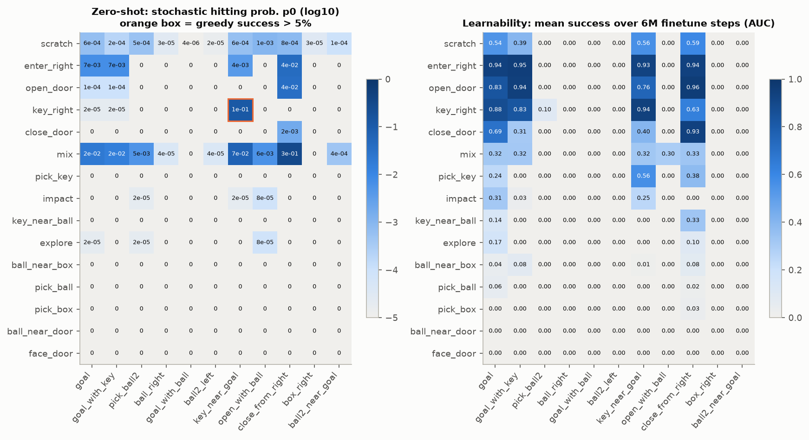

- 左圖：每個練過的 agent 在 11 個下游任務上的 zero-shot 隨機命中率 p0（log10）；橘框代表 greedy 成功率 > 5%，整張表只有 1 格（key_right → key_near_goal 11%）。**幾乎所有 agent 的 zero-shot 表現都是 0。**
- 右圖：同一批 agent 對同一批任務的 learnability（6M 步 finetune 的 AUC），從 0.00 到 0.96。
- **最反直覺的一點：p0 不是 learnability。** open_door / close_door agent 對 goal 的 p0 是 1e-4 和 < 6e-5，比完全隨機的 agent（6.3e-4）**還低**，但 goal 的 AUC 是 0.83 / 0.69，遠高於 scratch 的 0.54。反過來，mix agent 的 p0(goal) = 2e-2（隨機的 30 倍），AUC 卻只有 0.32。
- p0 和 AUC 的 Spearman 相關只有 0.53–0.69（4 個可學的任務），而且大部分練過的 agent 的 p0 其實**低於**隨機策略：練習讓行為變窄（entropy 0.01–0.4），在新任務上幾乎不會「碰巧」成功。
- 最嚴格的版本（初始行為完全相同）：只搬 hidden layers、兩個 head 都歸零，所以初始策略和 scratch 一樣是均勻分布、V 一樣是 0，兩者唯一的差別是 hidden features。**兩個 agent 一開始的行為一模一樣，learnability 卻顯著不同**：

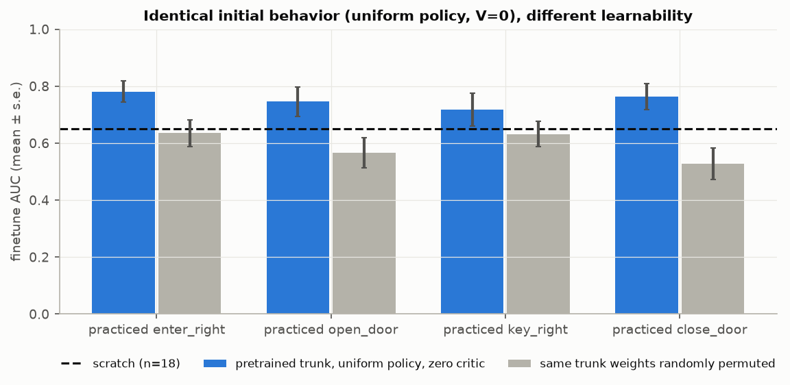

| hidden layers 來自 | 只搬表徵（行為與 scratch 完全相同） | 同樣的權重隨機打亂（控制組） |
|---|---|---|
| enter_right | **0.78**（vs scratch p = 0.004） | 0.64（n.s.） |
| open_door | **0.75**（p = 0.004） | 0.57（n.s.） |
| key_right | **0.72**（p = 0.009） | 0.63（n.s.） |
| close_door | **0.76**（p = 0.003） | 0.53（n.s.） |
| scratch | 0.65 | |

（goal / key_near_goal / close_from_right，每格 n = 36，Mann-Whitney；表徵 vs 打亂皆 p ≤ 0.0007。）打亂權重保留了權重的數值分佈、破壞了結構，結果回到 scratch，所以有用的是**學到的 feature 結構**，不是權重大小之類的優化效應。

### 2.2 先變得更會學，才變得會做（learnability before competence）

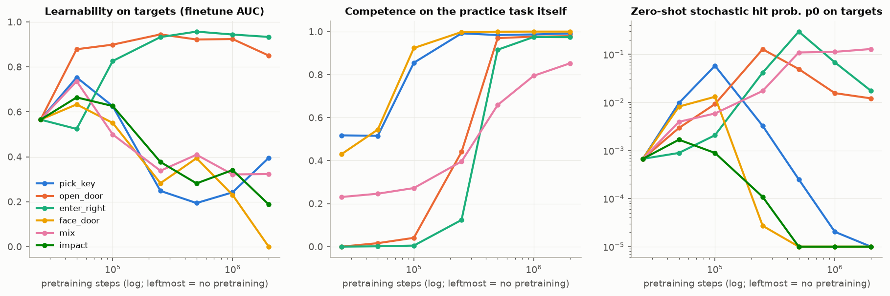

| 練習 | 練習步數 | 練習任務本身的成功率 | 下游 learnability（goal / key_near_goal / close_from_right 平均 AUC） |
|---|---|---|---|
| （無） | 0 | — | 0.57 |
| open_door | 50k | **2%** | **0.88** |
| open_door | 100k | 4% | 0.90 |
| open_door | 2M | 98% | 0.85 |
| enter_right | 100k | **0%** | **0.83** |
| enter_right | 250k | 12% | 0.93 |
| pick_key | 50k | 52% | 0.75 |
| pick_key | 250k | 99% | **0.25** |
| face_door | 50k | 54% | 0.63 |
| face_door | 2M | 100% | **0.00** |

- 對 open_door / enter_right 來說，**learnability 在練習任務本身還沒學會時就已經上升**，這就是核心問題的直接正面答案。
- 後續用 18 個 runs 重做 50k（`POTENTIAL.md` 2.5）：整個網路搬時 open_door@50k 的增益是 +0.34（p = 1e-10），只重置 critic 時只剩 +0.10。早期的好處有一大半來自 critic 的 shaping，不只在 actor。
- 對 pick_key / face_door / mix / impact 則是**倒 U 形**：一點點練習（50k）有幫助，熟練之後 learnability 崩掉。
- **這個崩掉主要來自 critic**（在 pick_key 和 mix 上驗證）：在每個 checkpoint 都只重置 critic 再 finetune（`exp_ckptnc`，同一組 3 個目標；這組實驗配對的 scratch 是 0.65）：

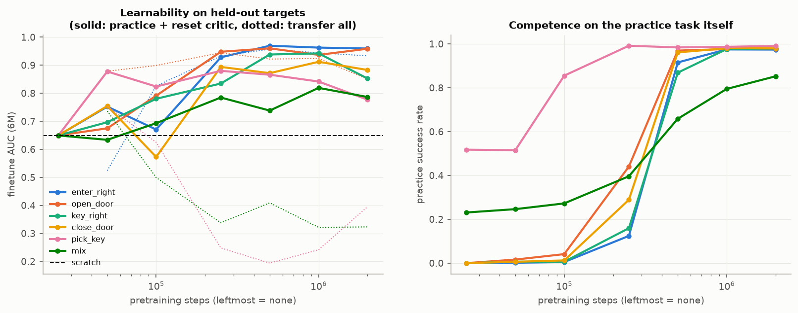

| 練習 | 練習步數 | 練習任務本身的成功率 | 下游 learnability（重置 critic） | 對照：全搬 |
|---|---|---|---|---|
| enter_right | 250k | 12% | **0.93** | 0.93 |
| open_door | 100k | 4% | 0.79 | 0.90 |
| open_door | 250k | 44% | **0.95** | 0.94 |
| key_right | 250k | 16% | 0.83 | — |
| close_door | 250k | 29% | 0.89 | — |
| pick_key | 50k → 250k → 2M | 52% → 99% → 99% | **0.88 → 0.88 → 0.78** | 0.75 → **0.25** → 0.39 |

- 重置 critic 後，learnability 在練習任務還只會 12–44% 時就接近最高點；而且**熟練之後不再崩掉**（pick_key 一路維持在 0.78–0.88；mix 從 0.63 升到 0.79，全搬則從 0.74 掉到 0.32）。全搬時的倒 U 形主要是舊期望造成的。
- 在 50k–100k 這種非常早期的 checkpoint，全搬有時比重置還好（open_door 100k：0.90 vs 0.79）。推測原因：那時 critic 只看過很少的獎勵，期望還接近 0（沒有直接量測），這和「期望越錯越有害」的模型一致。
- 實務含意：frontier expansion / 步數最高的練習量很小（約 250k 步，即 2M 的 1/8），前提是不把 critic 一起搬過去。

### 2.3 Learning Frontier：多數練習讓 frontier 縮小

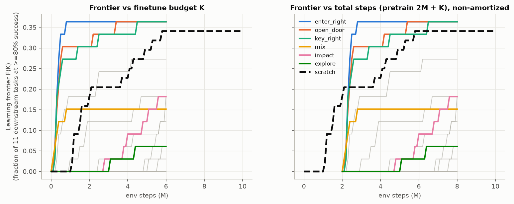

- 左圖：F(K) vs finetune 步數；右圖：x 軸加上 2M 預訓練步數（不攤提）。
- 14 種練習中只有 4 種（enter_right、open_door、key_right、close_door）在任何 K 都高於 scratch；結論在 τ = 0.5 / 0.8 / 0.95 都一樣。
- 即使不攤提（右圖），enter_right 2.8M 步就達到 scratch 6M 步才達到的 frontier。
- Frontier 天花板（全搬時）：11 個下游任務中有 6 個（ball_right、box_right、goal_with_ball、ball2_left、ball2_near_goal、以及 pick_ball2 的大部分）**沒有任何練習能解鎖**；只有 mix 能讓 open_with_ball 在 5/12 個 seed 學會。也就是說，全搬時練習多半是**加速**，很少**解鎖**。重置 critic 後 pick_ball2 和 open_with_ball 被部分解鎖（2.4）；最難的 5 個任務沒有在重置 critic 的條件下測試。

**Frontier Expansion / GPU-hour 是否有意義？** 在這個設定裡 GPU 時間和 env steps 幾乎是常數比例（批次訓練下約 0.6 µs / step），所以「每 GPU-hour」等價於「每步」。純量版本有三個問題：(1) 依賴 finetune 預算 K（K 大時 scratch 會追上）；(2) 多數情況是**負的**；(3) 依賴有多少下游任務共用這次預訓練。比較有意義的是 **break-even 任務數 N\* = 預訓練成本 / 每個下游任務省下的步數**：

| 練習（2M 步） | 每個下游任務的期望步數（上限 6M） | N* |
|---|---|---|
| scratch | 2.91M | — |
| enter_right | 0.32M | **0.77**（一個任務就回本） |
| open_door | 0.72M | 0.91 |
| key_right | 1.04M | 1.07 |
| close_door | 2.50M | 4.79 |
| 其餘 10 種 | 4.07M – 6.00M | ∞（永遠不回本） |

### 2.4 負遷移的來源：critic（value head）

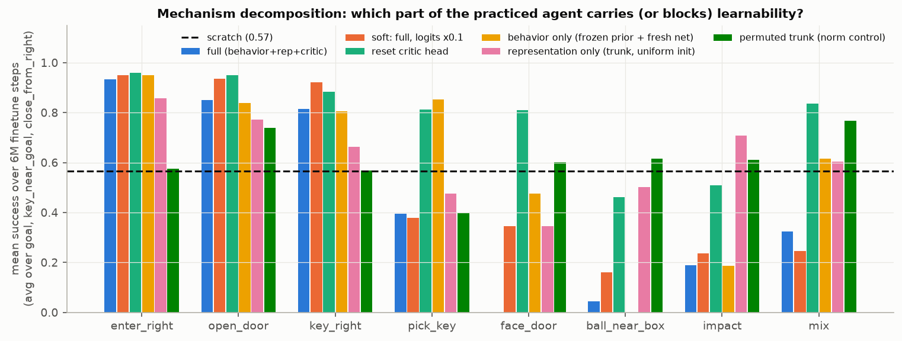

把練過的 agent 拆開來遷移（3 個目標任務平均 AUC，scratch = 0.57）：

| 練習 | 全部搬（行為 + 表徵 + critic） | soft（logits ×0.1，恢復 entropy） | **只重置 critic head** | 只搬行為（凍結舊策略當 prior + 新網路） | 只搬表徵（hidden layers，heads 歸零） | 打亂後的 hidden weights（控制組） |
|---|---|---|---|---|---|---|
| enter_right | 0.93 | 0.95 | 0.96 | 0.95 | 0.86 | 0.57 |
| open_door | 0.85 | 0.94 | 0.95 | 0.84 | 0.77 | 0.74 |
| key_right | 0.82 | 0.92 | 0.88 | 0.80 | 0.66 | 0.57 |
| pick_key | 0.39 | 0.38 | **0.81** | 0.85 | 0.48 | 0.40 |
| face_door | **0.00** | 0.35 | **0.81** | 0.48 | 0.35 | 0.60 |
| ball_near_box | 0.04 | 0.16 | 0.46 | 0.00 | 0.50 | 0.62 |
| impact | 0.19 | 0.24 | 0.51 | 0.19 | 0.71 | 0.61 |
| mix | 0.32 | 0.25 | **0.84** | 0.61 | 0.60 | 0.77 |

- **只把 critic 最後一層（257 個參數）歸零，就把多數負遷移翻成正遷移。**
- **soft（把策略 entropy 恢復到 ~1.7）沒用** → 「練習讓探索崩掉」不是主因。
- 正遷移的部分在「只搬行為」和「只搬表徵」都還在 → 有用的是**技能**（前置鏈的習慣 + 對應的 features）。

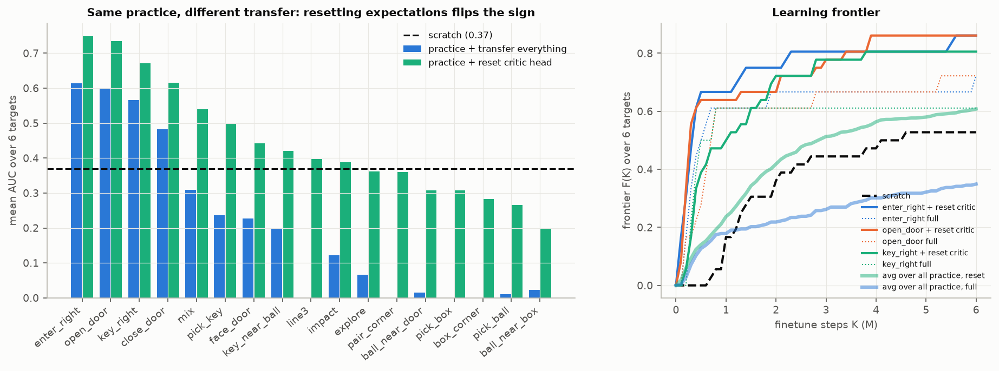

**完整 sweep**：17 種練習（含 3 個 door-free 困難任務）× 6 個目標（含 scratch 永遠學不會的 open_with_ball、pick_ball2）× 3 預訓練 seed × 2 finetune seed，全部只重置 critic；另外為 14 種原始練習多跑一組全搬作對照。

| | 高於 scratch（0.37）的練習數 | 14 種練習中「重置 > 全搬」 |
|---|---|---|
| 全部搬 | 4 / 14 | — |
| **只重置 critic** | **10 / 17** | **14 / 14**（11 種 p ≤ 0.01，Mann-Whitney） |

**解鎖 scratch 學不會的任務**（scratch：pick_ball2 0/36、open_with_ball 0/36）：

| 練習 | pick_ball2：全搬 → 重置 | open_with_ball：全搬 → 重置 |
|---|---|---|
| enter_right | 1/3 → **6/6**（AUC 0.01 → 0.64） | 0/3 → 1/6 |
| key_right | 0/3 → **5/6**（0.00 → 0.55） | 0/3 → 1/6 |
| open_door | 1/3 → **4/6**（0.06 → 0.34） | 0/3 → **3/6**（0.00 → 0.26） |
| close_door | 0/3 → 2/6 | 0/3 → 2/6 |

所以「練習 + 重置期望」不只是加速，**是真的擴大了 Learning Frontier**；而「全部搬」幾乎只會加速前置鏈完全對齊的任務。

**成本（break-even N\*，6 個目標，scratch 每個任務期望 3.80M 步，2M 步預訓練）**：

| 練習 | 全搬 N* | 重置 critic N* |
|---|---|---|
| enter_right | 1.33 | **0.87** |
| open_door | 1.42 | **0.90** |
| key_right | 1.61 | **1.09** |
| close_door | 2.89 | 1.35 |
| mix | ∞ | **1.99** |
| pick_key | ∞ | **2.56** |
| face_door | ∞ | 4.70 |
| key_near_ball | ∞ | 6.94 |
| line3 / impact | — / ∞ | 13.2 / 22.8 |
| 其他 7 種 | ∞ | ∞ |

全搬只有 7 種練習會回本，重置 critic 後有 14 種；最好的練習在不到一個下游任務內就把 2M 步的預訓練成本賺回來。

重置 critic 之後仍然有害的只剩極端僵化的習慣：ball_near_box（entropy 0.01，無限撿起/放下的迴圈）0.20 < scratch 0.37（p = 0.011），它的「只搬行為」也是 0.00。

### 2.5 為什麼 critic 有害？逐一排除

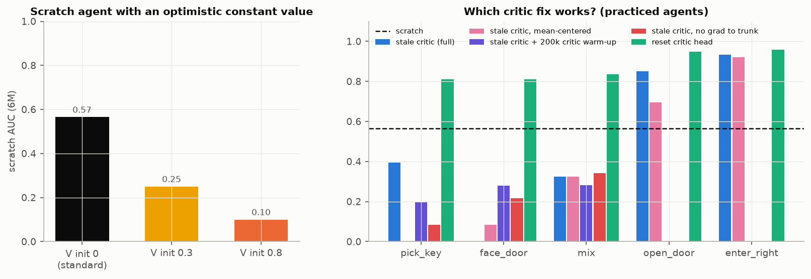

1. **舊 critic 對新任務極度樂觀**：練過的 critic 在新任務的所有狀態上都預測 V ≈ 0.7–0.95（練習任務很快就拿到獎勵），但新任務的真實 V ≈ 0。
2. **只有樂觀、沒有任何任務資訊也會傷害**：從 scratch 開始，只把 critic bias 設成 0.8（其他完全一樣），AUC 0.57 → **0.10**（3 個目標各只有 1/6 個 seed 學會）；設 0.3 → 0.25。這和教科書的 "optimism in the face of uncertainty" 相反。
3. **不是「失望期」的暫時效應**：先凍結 actor、讓 critic 自己適應 200k 步（warm-up）→ 仍然很差（pick_key 0.20、face_door 0.28）。
4. **不是 critic 梯度破壞共享表徵**：讓 value 梯度不進 trunk（detach）→ 更差（pick_key 0.08）；追蹤 dormant neurons / feature rank，在舊 critic 下**幾乎沒變**（dormant 比例始終在 0.07–0.09，srank 224–229）。
5. **只扣掉平均值（置中）也沒用**：pick_key 置中後 0.00 → 不論是水位錯還是形狀錯都會傷害。
6. **不需要共享 trunk 也會發生**：改成 actor 和 critic 完全分開的兩個網路（`exp_sep`，重新預訓練），全搬仍然有害，只重置 critic head 就夠：

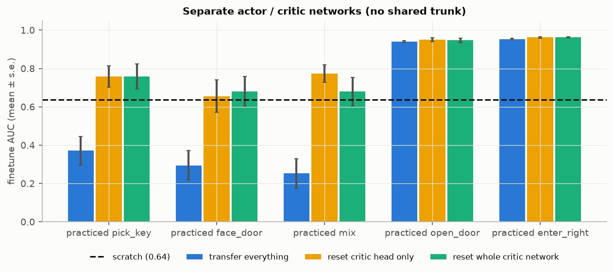

| 練習 | 全搬 | 只重置 critic head | 重置整個 critic 網路 |
|---|---|---|---|
| pick_key | 0.37 | **0.76**（p < 0.0001） | 0.76 |
| face_door | 0.29 | **0.66**（p = 0.001） | 0.68 |
| mix | 0.25 | **0.77**（p < 0.0001） | 0.68 |
| open_door / enter_right | 0.94 / 0.95 | 0.95 / 0.96 | 0.95 / 0.96 |

（scratch 0.64，每格 n = 18。）actor 和 critic 沒有任何共享參數時，舊 critic 依然有害，所以傷害只能經由 advantage（學習訊號）傳過去。

7. **關鍵差別在學習訊號**：重置 critic 後 3 次 update（24k 步）內 entropy 從 0.42 跳到 1.49、open_door 發生率從 0.001 跳到 0.052；舊 critic 下 entropy 維持在 0.46，open_door 在 0.4M 步內都是 ~0。但只恢復 entropy（soft）又不夠 → 舊 critic 同時做了兩件壞事：讓 entropy bonus 失效，以及淹沒真正的成功訊號。

### 2.6 學習時間 = discovery + consolidation

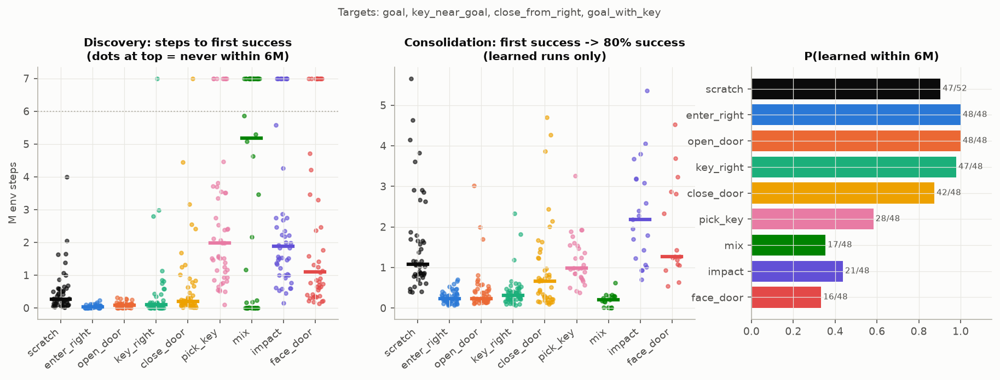

- 有用的練習縮短的是 **consolidation**（第一次成功 → 80%）：scratch 中位數約 1.1M，enter_right / open_door / key_right 約 0.25M。discovery 本來就很快（scratch 0.2M）。
- 有害的練習延遲的是 **discovery**：pick_key 中位數 2M、impact 1.9M、mix 呈雙峰（不是立刻就是永遠不會）。

### 2.7 Residual chain：練出來的習慣等於「環境幫你做完前半段」嗎？

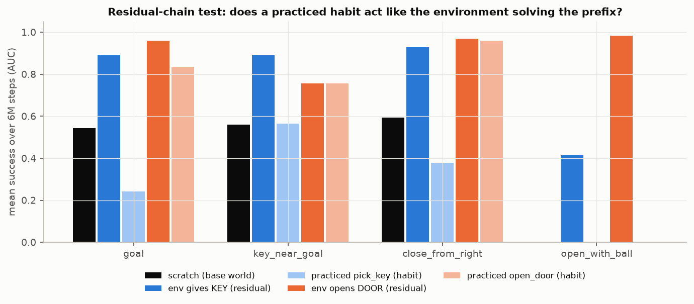

t80 中位數（括號內是學會的 seed 數）：

| 目標 | scratch | 環境直接給鑰匙 | 練過 pick_key | 環境直接開門 | 練過 open_door |
|---|---|---|---|---|---|
| goal | 1.97M（4/4） | 0.59M（6/6） | ∞（1/3） | 0.29M（6/6） | 0.49M（3/3） |
| close_from_right | 1.34M | 0.36M | 4.21M | 0.23M | 0.17M |
| open_with_ball | 永遠學不會 | 3.76M（5/6） | 永遠學不會 | **0.09M（6/6）** | **永遠學不會** |

- open_door 的習慣 ≈ 環境幫你開門（goal、close_from_right）→ **正遷移 = 學習「剩下的鏈」**。
- 但 pick_key 的習慣遠不如「環境給鑰匙」：agent 確實每次都會撿起鑰匙，到達的狀態一樣，差別在於它帶著一個對新任務錯誤的 critic，加上撿到鑰匙之後的行為從沒被訓練過（練習 episode 在成功時就結束了）。
- 練過 open_door 的 agent 學不會 open_with_ball：習慣把它帶到「手上拿著鑰匙、門開著」的狀態，而 open_with_ball 需要先**放掉**鑰匙。

### 2.8 Self-sabotage：在任務上訓練反而讓它更難學

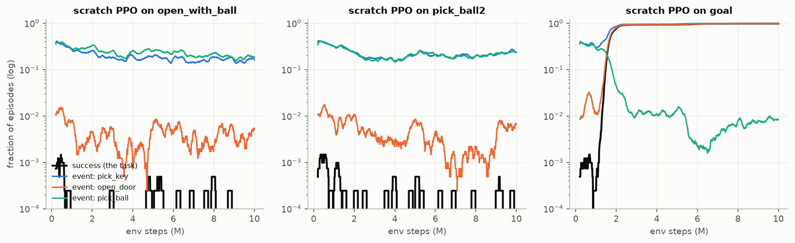

- open_with_ball 和 pick_ball2 從 scratch 開始，第一次成功在 0.07–0.3M 步就出現（p0 ≈ 1e-3，比 goal 還高），**但 10M 步內 0/4 學會**。
- 訓練過程中任務自己的成功率從 1.2e-3 降到 ~0，open_door 事件率從 1.2e-2 降到 3e-3，「整個 episode 什麼都沒撿」的比例從 0.33 升到 0.62：**越練越被動**。
- 機制和 2.5 相同：幾次罕見成功讓 critic 對很多狀態產生樂觀的泛化 → normalized advantage 變成雜訊 → 策略漂移、entropy 下降。驗證：每 100k / 500k 步把 value head 歸零 → entropy 保持在 1.75（原本掉到 1.2），**但仍然 0/6 學會**。所以 critic 解釋了「探索崩潰」，但這兩個任務學不會還有另一個原因：它們都需要在中途**放掉**一個之前有價值的物品（鑰匙）。
- 先前猜的「欺騙性順序（先撿球擋住路）」被反證：撿球先 / 撿鑰匙先的比例訓練前後都維持 1:1。

### 2.9 在真實 MiniGrid 上重現

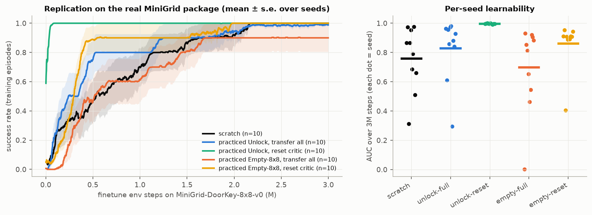

用 repo 內真正的 MiniGrid 套件（CPU、有視線遮擋、7 個動作中只用前 6 個、`DoorKey-8x8` 的 T = 640），同一個網路、同一組 PPO 超參數。練習 0.5M 步（Unlock：拿鑰匙開門，對齊 DoorKey 的前半段；Empty-8x8：走到 goal，不對齊），然後在 DoorKey-8x8 finetune 3M 步，每個條件 10 個 seed：

| DoorKey-8x8 | AUC 平均 ± s.e. | 最差的 seed |
|---|---|---|
| scratch | 0.76 ± 0.07 | 0.31 |
| 練 Unlock，全部搬 | 0.83 ± 0.07（vs scratch p = 0.43，不顯著） | 0.30 |
| **練 Unlock，只重置 critic** | **0.997 ± 0.001**（vs 全搬 p = 0.0002） | **0.99** |
| 練 Empty-8x8，全部搬 | 0.70 ± 0.09 | **0.00** |
| 練 Empty-8x8，只重置 critic | 0.86 ± 0.05（vs 全搬 p = 0.076） | 0.41 |

（Mann-Whitney U。）在真實 benchmark 上，練一個和目標前半段完全對齊的任務、然後整個網路搬過去，**幾乎沒有好處**；同樣的練習只要重置 critic，10 個 seed 全部幾乎立刻學會。也就是說，練習帶來的 learnability 其實已經在網路裡，但被舊的期望遮住了。影片 `videos/3_the_result_is_the_same_in_the_real_minigrid.mp4` 用 seed 0（scratch 的學習速度在 10 個 seed 中排中間）：zero-shot 時兩個練過 Unlock 的 agent 有 97% 的局會開門、0% 走到終點，critic 預期分別是 0.86（全搬）和 0（重置）；finetune 0.1M 步後測試 32 局，重置 critic 100%、全搬 47%、scratch 0%；0.3M 步後全搬 100%、scratch 25%。

### 2.10 其他被反證或部分支持的嘗試

- **內在動機預訓練**（explore / impact）：不知道下游。全搬時比 scratch 差（AUC 0.02–0.23 vs 0.42–0.81，n = 12）；重置 critic 後約等於 scratch（0.36–0.39 vs 0.37）。沒有擴大 frontier。
- **door-free 困難練習**（line3：學會需要 ~1M 步，比 open_door 難）：全搬時下游 AUC 0.24 / 0.28 / 0.11，全部低於 scratch；重置 critic 後 0.28–0.40，約等於 scratch（0.37）。所以「練困難的任務」**部分成立**：困難練習的排名確實高於簡單練習（ρ = 0.66），但同樣難度下，覆蓋瓶頸（門）的練習遠好於不覆蓋的（open_door 0.74 vs line3 0.40）。難度之所以有預測力，是因為這個世界最難的事件剛好就是瓶頸事件。
- **Proxy learnability**（在其他練習任務上 0.5M 步的學習速度）：所有練過的 agent 都比 scratch 慢；在不需要門的 proxy 任務上的 learnability 與下游 learnability 相關 ρ = −0.17 → learnability 不是 agent 的單一純量屬性。
- **不終止的練習**（成功後繼續到 T，只有第一次成功給獎勵）：critic 水位從 0.8 降到 0.2–0.5；face_door 0.00 → 0.87、ball_near_box 0.04 → 0.37，但 pick_key、open_door 反而變差。不是通用解法。
- **PPO 的兩個必要零件**：拿掉 advantage normalization → 所有任務都學不會（訊號太小，打不過 entropy bonus）；V ≡ 0（不用 critic）→ 所有任務都學不會（長鏈的 credit assignment 需要 critic）。critic 與 normalization 是學習的必要條件，同時也是負遷移的來源。

---

## 3. 假說檢驗總表

| 假說 | 結論 | 證據 |
|---|---|---|
| H1 Exploration：練習提高新任務的命中率 p0，所以比較好學 | **部分成立，不是主因** | p0 與 AUC 相關 0.53–0.69；但 open_door / close_door 的 p0 比隨機還低，learnability 卻更高；mix 的 p0 最高，learnability 卻低於 scratch（2.1） |
| H1b 練習讓探索崩潰（entropy 太低）是負遷移的原因 | **反證** | soft 把 entropy 恢復到 1.7，仍然沒用（2.4） |
| H2 Representation：練出來的 features 讓新任務好學 | **成立（中等）** | 初始行為完全相同時，只搬 hidden layers：0.72–0.78 vs scratch 0.65（4 種練習皆 p < 0.01，n = 36）；打亂權重的控制組回到 scratch（2.1） |
| H3 Optimization / plasticity：練習破壞可塑性 | **部分成立，但不是透過表徵** | 單一任務練習讓「學新的簡單任務」變慢（proxy learnability 全部低於 scratch）；但 dormant neurons / srank 沒變，detach 也沒用（2.5、2.10） |
| H4 Learning signal：練習改變了學習訊號的品質 | **成立，主因** | 只重置 critic 就翻轉負遷移（共享 trunk 與分開網路都成立）；只設 V = 0.8 就能把 scratch 搞壞；self-sabotage 也是同一機制（2.4、2.5、2.8） |
| H5 Behavior prior：有用的是前置鏈上的習慣 | **成立** | 只搬行為（凍結舊策略當 prior）就保留大部分正遷移；open_door 習慣 ≈ 環境幫你開門（2.4、2.7） |
| H6 Learnability before competence | **成立** | open_door 50k 步：自身 2% 成功，下游 AUC 0.57 → 0.88；重置 critic 時，練習任務只會 12–44% 的 250k 步階段，下游已達 0.83–0.95（2.2） |
| H7 不看下游就能預測哪種練習擴大 frontier | **大致反證，有一個例外** | entropy（ρ = −0.03）、coverage（0.34）、novelty（0.26）、interaction、srank、dormant 都不行；proxy learnability 0.43；**練習任務的隨機難度 0.66–0.77** 是唯一像樣的，但它在同難度下分不出好壞；最強的「開門率」（0.78–0.81）用到了下游結構（`fig_predictors.png`） |
| H8 練困難的任務比較好 | **部分成立** | 重置 critic 後，困難 > 簡單；但 door-free 困難練習只達到 scratch 水準，覆蓋瓶頸的困難練習才遠高於 scratch（2.10） |
| H9 Frontier Expansion / GPU-hour 是好指標 | **部分成立** | 只在比較同一個 K、同一組下游時有意義；多數是負值；建議改用 break-even N*（2.3） |
| H10 Optimism in the face of uncertainty 有助學習 | **在本設定反證** | V init 0.8 → AUC 0.57 → 0.10（2.5） |
| H11 open_with_ball 學不會是因為欺騙性的順序 | **反證** | 先撿球 / 先撿鑰匙始終 1:1；真正的現象是越練越被動（2.8） |
| H12 內在動機預訓練（不知道下游）能擴大 frontier | **反證** | explore / impact 全搬時低於 scratch，重置 critic 後約等於 scratch（2.10） |

---

## 4. 機制解釋

### 4.1 Learnability 的兩個階段

```
              discovery                      consolidation
  initial ─────────────────> first success ─────────────────> reliable (80%)
  policy     needs p0 > 0                    needs a clean learning signal
             (exploration)                   to propagate credit along the chain
```

- **discovery** 由探索決定（p0）。在這個世界，scratch 只需要 0.2M 步；只有有害的練習會讓它延遲到 1–5M 步或永遠不發生。
- **consolidation** 才是真正的瓶頸（scratch 約 1.1M 步），也是有用的練習真正縮短的部分（約 0.25M 步）：如果前半段的鏈已經是穩定的習慣，credit 只需要傳過剩下的鏈（residual chain，2.7）。

### 4.2 學習訊號：為什麼舊 critic 有毒

```
PPO 每個樣本的更新方向  ∝  Â_t · ∇log π(a_t | s_t)
 = (A − mean(A)) / std(A)                    ← advantage normalization
A_t = Σ_k (γλ)^k δ_{t+k},   δ = r + γ V(s') − V(s)

把 critic 寫成 V = V_true + e（e 是 critic 的誤差）：
  A = A_signal（來自真正的獎勵） + A_error（來自 e）

對一個「還不會做」的稀疏獎勵任務：
  V_true ≈ 0，A_signal 只在罕見的成功軌跡上不為 0

  fresh critic：e ≈ 0
     沒有訊號時 A ≡ 0 → 只剩 entropy bonus → 探索在幾次 update 內恢復
     有訊號時 A ≈ A_signal → 沒有被稀釋
  stale critic：e ≈ 0.8（在練習任務上學到的期望）
     timeout 時 δ = 0 − 0.8，經 GAE 往前擴散 → A_error 的變異數很大，且和任務進度無關
     normalization 把總變異數固定成 1 → A_error 變成 O(1) 的假訊號
       (a) 壓過 0.01 的 entropy bonus → 行為凍結在舊習慣
       (b) 淹沒罕見的 A_signal → 就算有探索也學不起來
```

由這個模型可以導出、而且都驗證過的預測：

1. 只把 V 初始化成常數 0.8（沒有任何任務資訊）也會傷害 scratch → 驗證：0.57 → 0.10。
2. 把 critic 歸零就能恢復 → 驗證：多數負遷移翻正。
3. 讓 critic 先適應（warm-up）或阻止它改 trunk（detach）都不夠，因為 critic 在新任務上收斂到「正確的 0」需要時間，而且一有罕見成功又會重新泛化出樂觀 → 驗證：都沒用。
4. 舊期望剛好對的時候不會傷害，錯的時候才會 → 驗證：enter_right 的舊 critic 預期「進右房間後很快有獎勵」，對 goal 類目標是對的（full 0.93 ≈ reset 0.96）；對需要先放下鑰匙、比較久才有獎勵的 pick_ball2 是錯的（full 0.01 vs reset 0.64）。
5. 即使是 scratch，幾次罕見成功後 critic 的樂觀泛化也會造成同樣的漂移 → 驗證：self-sabotage，且定期重置 critic 可以保住 entropy。
6. 傷害經由 advantage 傳遞、不需要共享參數 → 驗證：actor / critic 完全分開時，全搬仍然有害，只重置 critic head 就能修好。

### 4.3 合在一起的原則

```
practice  ─┬─> skills（actor + features）：把新任務前半段的鏈變成習慣
           │      → 縮短 consolidation（正遷移，只在前置鏈對齊時）
           │
           └─> expectations（critic）：對新任務自信地錯
                  → normalized advantage 裡的假訊號
                  → 凍結行為 + 淹沒真訊號（負遷移，幾乎總是）

learnability(A | practice B) ≈ learnability(residual chain of A after B's habits)
                               × [critic is calibrated for A, i.e. ≈ 0 for an unsolved A]
```

所以 "Can an agent become better at learning new tasks, even before it becomes better at performing them?" 的答案是：**可以，前提是它帶來的是技能而不是期望。** 對一個還不會做的稀疏任務，最好的期望就是「我不知道」（V = 0），而這正是新初始化的 critic 免費提供的。

---

## 5. 最值得繼續研究的方向

1. **Expectation-free transfer 的通用性**：在 LLM 的 RL finetuning（value head 通常從 reward model 或前一階段初始化）、robotics sim-to-real、continual RL 中，「只重置 critic」是否同樣能把負遷移翻正？這是成本最低、最有機會產生廣泛影響的方向。
2. **Calibrated ignorance**：設計一個「對還沒解過的任務預測 0、對解過的任務才自信」的 critic（例如以成功次數調整 value 的 prior、ensemble 不確定性 shrink 到 0）。它同時能處理遷移時的舊期望和 scratch 的 self-sabotage。
3. **Normalization 的訊雜比**：advantage normalization 是學習的必要條件，也是把 critic 誤差放大的元兇。可以研究按「訊號強度」調整的 normalization（例如只在 batch 中有獎勵時才放大），或明確估計 A_signal / A_error。
4. **瓶頸事件的無監督發現**：唯一能預測哪種練習有用的是「開門率」，也就是世界的瓶頸事件。如果能在不看下游的情況下找出世界的瓶頸（例如可達狀態集合因某事件而大幅擴張），就能自動挑選練習。
5. **「放下」類的技能是 learnability 的硬障礙**：需要中途放掉一個之前有價值的物品的任務，從 scratch 和多數練習都學不會。這類 non-monotonic subgoal 值得單獨研究。
6. **Learnability 的廉價量測**：learnability 在練習初期（50k–100k 步）就達到高峰，代表「frontier expansion / 步」最高的練習量其實很少。可以研究能不能用很少的步數估計一個 agent 的 learnability。

---

## 6. 重現

```
learnability/
  gridworld.py   GPU world: layouts, dynamics, 27 predicates, intrinsic rewards, world variants
  learn.py       population-batched PPO (train), probes (probe / rep_stats), every experiment (exp_*),
                 CPU PPO on the real MiniGrid package (mg_train / exp_mg)
  analyze.py     metrics (AUC, t80, discovery), frontier, all figures, MiniGrid-rendered videos
  run_all.sh     runs every experiment in order, then figures and videos
  results/       raw logs of every run (*.pt), results/mg/ for real MiniGrid, summary.txt
  figs/          all figures in this report
  videos/        demo videos
  ckpt/          pretrained / finetuned checkpoints
```

環境與指令見 `README.md`（`uv sync` 之後 `./run_all.sh`）。各實驗與 `learn.py` 函式的對應：

| 實驗 | 函式 | 結果檔 |
|---|---|---|
| scratch 基準（22 任務 × 4 seeds × 10M） | `exp_scratch` | `results/scratch.pt` |
| 練習動物園（14 條件 × 3 seeds × 2M，存 6 個 checkpoint） | `exp_pretrain` | `results/pretrain.pt`、`ckpt/pre_*.pt` |
| zero-shot probe | `exp_probe` | `results/probe.pt` |
| 遷移矩陣（14 × 11 × 3） | `exp_finetune` | `results/finetune.pt` |
| 高樣本數重複（10 條件 × 4 目標 × 12） | `exp_reps` | `results/reps.pt` |
| 機制拆解 | `exp_mech` | `results/mech.pt` |
| critic 診斷（warm-up / detach） | `exp_critic` | `results/critic.pt` |
| 樂觀初始化 / 置中 critic | `exp_optimism` | `results/optimism.pt` |
| 表徵追蹤 | `exp_damage` | `results/damage*.pt` |
| learnability vs 練習步數 | `exp_ckpt`、`exp_ckptnc` | `results/ckpt.pt`、`results/ckptnc.pt` |
| 重置 critic 的完整 sweep | `exp_ncsweep` | `results/ncsweep.pt` |
| 只搬表徵（高樣本數） | `exp_rep_only` | `results/reponly.pt` |
| 分開的 actor / critic 網路 | `exp_sep` | `results/sep.pt` |
| residual chain | `exp_residual` | `results/residual.pt` |
| door-free 困難練習 | `exp_doorfree` | `results/doorfree.pt` |
| 不終止的練習 | `exp_once` | `results/once.pt` |
| proxy learnability | `exp_proxy` | `results/proxy.pt` |
| normalization / V ≡ 0 / std floor | `exp_drift`、`exp_nocritic`、`exp_floor` | `results/drift_*.pt` 等 |
| 定期重置 critic | `exp_vreset` | `results/vreset.pt` |
| 真實 MiniGrid（Unlock / Empty → DoorKey-8x8） | `exp_mg`（`run_mg.sh`） | `results/mg/*.pt` |
| 影片用的 checkpoint | `exp_demo`、`exp_demo2`（goal：scratch / open_door / face_door 全搬 / face_door 重置 critic，各 12 個 seed）、`exp_mg --steps` | `results/demo*.pt`、`ckpt/demo2_*.pt`、`ckpt/mg_demo_*.pt` |

### 影片

| 檔案 | 內容 | 佐證 |
|---|---|---|
| `videos/0_skills_help_wrong_expectations_stop_learning.mp4` | 影片 1 → 影片 2 → 影片 3 接在一起 | 全部 |
| `videos/1_practice_can_make_an_agent_learn_faster_or_slower.mp4` | 從零開始、練過 open_door、練過 face_door（全搬）在同一個 goal 佈局並排；zero-shot 三個都失敗，但練過 open_door 的已經會拿鑰匙開門、練過 face_door 的會走到門前；接著看 finetune 0.5M、3M 步後。每組 12 個 seed，播 AUC 中位數的那一個，下方是 12 個 seed 的學習曲線 | 2.1、2.4 |
| `videos/2_the_old_critic_stops_learning.mp4` | 練過 face_door，全搬 vs 只重置 critic head。兩邊 actor 相同、共用同一組隨機數，所以 zero-shot 動作完全一樣，只有 critic 預期不同（0.91 vs 0）；0.25M 步時全搬的仍站在門前盯著門（entropy 低），重置的到處探索；2M 步時重置的學會。4M 步內學會的 seed：全搬 3/12、重置 8/12、scratch 9/12 | 2.4、2.5 |
| `videos/3_the_result_is_the_same_in_the_real_minigrid.mp4` | 真實 MiniGrid DoorKey-8x8（原生畫面），scratch / Unlock 全搬 / Unlock 重置 critic，zero-shot、0.1M、0.3M 步，每個時間點另外測試 32 局 | 2.9 |
| `videos/4_without_practice_more_training_makes_the_agent_touch_fewer_objects.mp4` | 附錄，和練習無關：同一個沒有練習、從零開始的 agent 在 open_with_ball 訓練 0.1M / 1M / 2M 步並排，每個時間點另外跑 2048 局：拿鑰匙 40% → 23%，平均每局撿東西 3.3 → 1.6 次 | 2.8 |

影片中的文字全部是 ASD-STE100 風格的英文（短句、主動語態、現在式、一句一個意思）；檔名就是影片的主張。影片只有 rollout 畫面，沒有說明卡。影片 1、2、4 的環境是 `gridworld.py`（GPU 版、規則同 MiniGrid，用 MiniGrid 的 `Grid.render` 繪製，所以畫面相同）；只有影片 3 是官方 MiniGrid 套件。每個畫面下方的方塊表示這一局已經做到的事件，藍條是 critic 對這一局的預期回報，虛線標出畫面中的 agent 位於學習曲線的哪個時間點。

### 限制

- 主要結果來自自寫的 GPU MiniGrid 世界（無視線遮擋）與 PPO；真實 MiniGrid 只重現了核心比較（Unlock / Empty → DoorKey）。
- 只測了 PPO（advantage normalization、timeout 視為 terminal）；共享 trunk 與分開的 actor / critic 網路都驗證過。「舊 critic 有毒」的強度很可能取決於 normalization 和 timeout 的處理方式；off-policy / distributional critic 需要另外驗證。
- 下游任務都需要通過同一個瓶頸（門），所以「前置鏈對齊」的結論在任務結構更多樣的世界還需要檢驗。
- 每格 3–12 個 runs，學會與否常呈雙峰分布；報告中的平均值應搭配 P(learned) 一起看。
