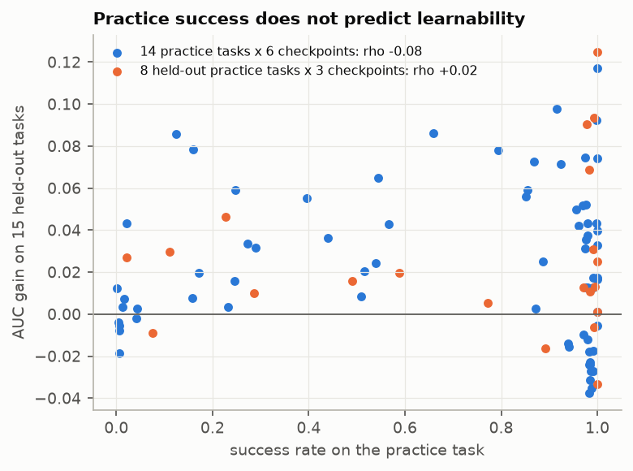
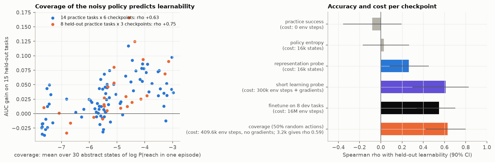
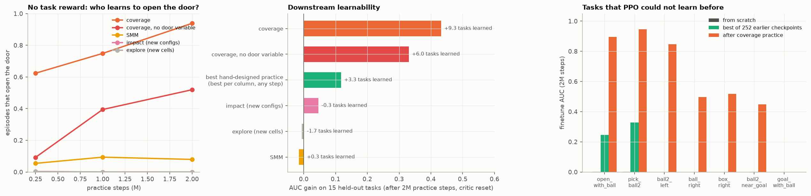

# 練習的價值是覆蓋率

所有數字都來自 `results/story.txt`（`uv run python analyze.py story`）。細節和其他實驗在 `POTENTIAL.md`。

## 1. 動機：Practice makes perfect，但算力太貴

先練習，再學真正的任務，policy 才學得起來。AlphaNIST 和 Play2Perfect 都顯示了這件事。

但練習很花算力。我們想解決 learning efficiency 的問題：

- 練什麼？
- 練多久？
- 能不能不靠人指定練習內容？

## 2. 問題：給很多個 pre-trained policy，哪一個學真正的任務最快？

### 評估方式

- 14 種練習任務 × 3 個 seed × 6 個時間點（50k–2M 步）= 252 個 pre-trained policy。另外有 8 種開發時完全沒用過的練習，當作 held-out 練習。
- 每個 policy 都在 23 個下游任務上 finetune 2M 步。下游任務分三類：要開門的、只在左房間的、門本來就開著的世界。其中 15 個任務只用來測試，開發時沒看過。
- Finetune 時重置 critic 的最後一層，因為舊 critic 會干擾學習（`REPORT.md` 2.4）。
- 「學得多快」= finetune 期間的平均成功率（AUC）減去 scratch。

### 結果：練習任務的成功率沒有預測力



| | 和 15 個 held-out 任務的 learnability 的相關 |
|---|---|
| 14 種練習（84 點） | ρ = −0.08 |
| 8 種 held-out 練習（24 點） | ρ = +0.02 |

成功率高，常常代表 policy 已經只會做練習任務這一件事。

影片 [`5_practice_success_does_not_show_what_the_agent_can_learn_next.mp4`](videos/5_practice_success_does_not_show_what_the_agent_can_learn_next.mp4)：三個 policy 的練習成功率都在 97–100%，學開門任務的增益卻分別是 +0.16、−0.02、+0.65。

## 3. 解法：抽象狀態的覆蓋率

### 做法

1. **定義抽象狀態**：手上拿什麼（沒有 / 鑰匙 / 紅球 / 箱子 / 紫球）× 門的狀態（鎖 / 開 / 關）× 在左房或右房，共 30 種。
2. **讓 policy 在沒有 reward 的世界跑**：每一步 50% 照 policy、50% 隨機動作。表中的數字用了 2,048 局；只跑 16 局（3,200 步）時，相關是 0.59，幾乎一樣。
3. **算覆蓋率**：每種抽象狀態在一局內被碰到的機率取 log，再對 30 種平均。碰不到的狀態會被重重扣分。

```
coverage = mean over 30 abstract states z of  log( P(reach z in one episode) + 1e-4 )
```

### 結果：覆蓋率是最好的指標



| 指標 | 和 held-out 任務的相關（90% CI） | 每個 policy 的量測成本 |
|---|---|---|
| 練習任務的成功率 | −0.08 [−0.35, +0.19] | 0 |
| Policy entropy | +0.03 [−0.17, +0.27] | 16k 個狀態 |
| 表徵 probe | +0.26 [+0.08, +0.45] | 16k 個狀態 |
| 短時間學習 probe | +0.61 [+0.30, +0.83] | 300k env steps + 梯度 |
| 直接在 8 個 dev 任務上 finetune | +0.55 [+0.34, +0.70] | 16M env steps |
| **覆蓋率（50% 隨機動作）** | **+0.63 [+0.42, +0.80]** | **409.6k env steps，不用梯度（只跑 3.2k 步時是 +0.59）** |

- 在 8 種 held-out 練習上，覆蓋率的相關是 +0.75。
- 完美指標的上限大約是 0.85，因為 ground truth 本身有 seed 的雜訊。
- 50% 隨機動作最好。只用 policy、不加隨機時，相關是 0.46。因為 finetune 會在 policy 附近探索，所以要量的是 policy 附近能碰到哪裡。
  例子：open_door 練到 98% 後，一站到開著的門前就一直開關門，只照 policy 走時幾乎進不了右房（3%）；加 50% 隨機後是 92%，而它學 goal 任務確實很快（AUC 0.89 vs scratch 0.20）。見 `POTENTIAL.md` 2.9 和影片 [`8_more_practice_makes_the_agent_stay_at_the_open_door.mp4`](videos/8_more_practice_makes_the_agent_stay_at_the_open_door.mp4)。
- **它也能決定何時停止 pre-training**：每種練習都在覆蓋率最高的 checkpoint 停下，held-out 增益是 +0.051。oracle 是 +0.060，隨機停是 +0.026，一律練到 2M 是 +0.017。

### 為什麼有效

學一個新任務要兩步：先碰到一次成功，再把偶爾的成功變成習慣。

- 覆蓋率高，代表 policy 附近能碰到很多局面，所以容易碰到第一次成功。
- 能穩定碰到深處的局面（例如開門後進右房），剩下要學的那段行為就短。

細節在 `POTENTIAL.md` 2.3。

## 4. 直接用覆蓋率當 pre-training 的目標

### 做法

不再人工指定 `open_door`、`enter_right` 這些練習任務，也沒有任何任務 reward。

```
每一局第一次碰到抽象狀態 z 時:
    reward = min(1/q(z), 1000) / 1000
    q(z) = 目前每局碰到 z 的機率（邊練邊更新）
```

- 越難碰到的狀態，reward 越高。已經常碰到的狀態，reward 變低，policy 會被推去下一個還不熟的地方。
- 1/q 就是「把覆蓋率拉高」的梯度方向：`sum_z log q(z)` 的梯度是 `sum_z (1/q(z)) * grad q(z)`。
- 對照組 SMM 每一步給 `-log rho(z)`（rho = 停留在 z 的時間比例）。它鼓勵平均分配時間，不是提高每種狀態被碰到的機率。

實作：`learn.py:121 train()` 的 `intrinsic="cover"`。

### 結果



同樣練 2M 步，同一套 23 個下游任務，finetune 時重置 critic：

| Pre-training | 15 個 held-out 任務的增益 | 比 scratch 多學會的任務 |
|---|---|---|
| **覆蓋率當目標** | **+0.43** | **+9.3** |
| 覆蓋率當目標（抽象狀態裡沒有門，只有「手上的東西 × 4×4 粗略位置」） | +0.33 | +6.0 |
| 最好的人工設計練習（每一欄取最好的練習和時間點） | +0.12 | +3.3 |
| impact（新的物件組態） | +0.05 | −0.3 |
| explore（新的格子） | −0.01 | −1.7 |
| SMM | −0.02 | +0.3 |

**沒有人告訴 policy 要開門，它自己學會了。**

| 開門的局的比例（沒有任務 reward） | 250k | 1M | 2M |
|---|---|---|---|
| 覆蓋率當目標 | 62% | 75% | 94% |
| 覆蓋率當目標（沒有門的變數） | 9% | 39% | 52% |
| SMM | 5% | 9% | 8% |
| impact、explore | 0% | 0% | 0% |

**以前 PPO 學不會的任務，現在學得會了**（finetune AUC）：

| 任務 | Scratch | 252 個舊 policy 裡最好的 | 覆蓋率 pre-training 後 |
|---|---|---|---|
| open_with_ball（拿鑰匙 → 開門 → 放下鑰匙 → 撿球） | 0.00 | 0.25 | **0.89**（3/3 seed 學會） |
| pick_ball2 | 0.00 | 0.33 | **0.95** |
| ball2_left | 0.00 | 0.00 | **0.85** |
| box_right | 0.00 | 0.00 | **0.52** |
| ball_right | 0.00 | 0.00 | **0.50** |
| ball2_near_goal | 0.00 | 0.00 | **0.45** |
| goal_with_ball | 0.00 | 0.00 | 0.00 |

open_with_ball 學得會，是因為 policy 為了碰到「拿著球」這類罕見狀態，自己練出了「放下鑰匙」（每局 99%）。

影片 [`7_reward_free_coverage_practice_makes_the_agent_open_the_door.mp4`](videos/7_reward_free_coverage_practice_makes_the_agent_open_the_door.mp4)：覆蓋率、SMM、explore 各練 1M 步，並排比較。

## 5. 注意事項

- **沒有對所有任務都最好的練習。** 在只需左房間的任務上，impact 比覆蓋率好（+0.20 vs +0.14）。練習的價值取決於未來任務的分布（`POTENTIAL.md` 2.4）。影片 [`6_different_practice_reaches_different_states.mp4`](videos/6_different_practice_reaches_different_states.mp4) 顯示兩種練習碰到的狀態完全不同。
- **抽象狀態是人定義的。** 拿掉門的變數後效果變小（+0.43 → +0.33），但仍遠好於人工設計的練習。
- **評估用的是重置 critic 的 finetune。** 如果把整個網路連 critic 一起搬，早期 checkpoint 的價值有一大半在 critic 裡（`POTENTIAL.md` 2.5）。
- 只有一個世界、每種 pre-training 3 個 seed。連續控制（例如 dexterous manipulation）裡，「每局碰到某種狀態的機率」需要離散化或密度模型來估，還沒驗證。

## 6. 重現

```bash
cd learnability
uv run python learn.py pretrain        # 14 practice tasks x 3 seeds, checkpoints 50k-2M
uv run python learn.py gt              # 252 checkpoints x 23 downstream tasks, critic reset
uv run python learn.py metrics         # coverage and the other reward-free metrics
uv run python learn.py pretrain_test   # 8 held-out practice tasks
uv run python learn.py gt_test
uv run python learn.py metrics_test
uv run python learn.py pretrain_cov    # coverage vs SMM as the pre-training objective
uv run python learn.py gt_cov
uv run python learn.py cover_pos       # coverage without the door variable
uv run python analyze.py story         # figs/fig_story_*.png, results/story.txt
```
